# Capability-Evolving Agent Architecture
## 可持續能力演化代理人架構
### System Design v1.9

---

# 1. 專案定位

Capability-Evolving Agent Architecture（CEAA）的核心目標，是研究 **Agent 如何將執行經驗轉換成可重用、可驗證、可治理的能力與決策資產**，並隨使用經驗累積，在維持正確性與安全邊界下逐步降低不必要的重複推論。

CEAA 的研究不預設資安、DevOps、企業自動化或任何特定應用領域；場景僅作為可控制、可量化的實驗工作負載，不能反向固化核心架構。

### 兩條互補的主要研究路徑

1. **Capability Evolution（能力演化）**：Agent 能否辨識既有能力的缺口，產生候選 Capability / Skill，經獨立測試、安全驗證、治理與必要的人員核准後啟用，讓後續任務使用？
2. **Experience-guided Decision（經驗輔助決策）**：Agent 能否先依任務特徵判斷是否值得檢索歷史經驗，藉由 **Decision Agent × Memory Router（`2.10 MADE）** 取得適用的執行證據，選擇經驗證路徑或輔助重新規劃，減少重複決策？

這兩條路徑共同依賴 **Raw Execution Trace → Independent Outcome Validation → Governed Experience Curation**。Reliability Evolution（診斷與恢復）及 Performance / Skill Complexity Evolution（效能與成本改善）建立在此證據層上，均屬逐階段驗證的研究方向，不視為已完成的 runtime 功能。

### 通用任務原則

```text
Task / Requirements
  → Main Agent / Decision Layer
      ├─ Validated & Compatible Experience → Reuse Execution Plan
      ├─ Partial Experience → Experience-assisted Planning
      └─ Missing / Insufficient Capability → Capability Gap → Evolution
  → Policy / Permission Check
  → Execution（當次輸入及當前狀態）
  → Independent Outcome Validation
  → Trace / Outcome → Governed Experience Curation
```

**已驗證計畫的重用不是對舊輸出的快取，也不是略過授權與執行驗證。** 新能力／新版本的建立與啟用須經既有 Secure Evolution Gate 與必要的人員核准；未命中記憶、信心不足、版本或前置條件不相容時，返回正常規劃／能力缺口流程。

### 能力缺口的正式演化分支（保留既有治理）

```text
Problem / Capability Gap
  ↓
Generate Candidate
  ↓
Independent Validation / Autonomous Tests
  ↓
Test Report
  ↓
Secure Evolution Gate + Policy
  ↓
Notify Administrator / Human Approval（依既有治理規則）
  ↓
Activate Approved Capability
  ↓
Future Reuse with Policy and Outcome Validation
```

遠期 Capability 分享／匯入仍是獨立、使用者明確 opt-in 的產品化方向：`31–54、`67–68 已保留其驗證與權限邊界；不構成初期研究 MVP 的實作範圍。

**狀態註記：** 上述為 CEAA 整體研究設計。`2.9 Package-local Decision、`2.10 MADE、Validated Path Registry 與跨 Agent 組織仍為 **Design Defined / Not Implemented**；已完成能力請依 `58 及 `71 的階段／現況界線判讀。

---

# 2. 核心研究假說

傳統 Agent 的能力通常主要來自：

- 底層模型
- 人類提供的工具
- Workflow
- Prompt
- Memory
- RAG

本研究增加另一條成長軸：

## Capability Scaling

底層模型負責：

> 面對未知問題時思考。

Capability Library 負責：

> 保存已經學會如何完成的工作。

Evolution Engine 負責：

> 找出還不會的事情，並嘗試建立能力。

Testing Agent 負責：

> 主動挑戰新能力，確認其可靠程度。

Human Governance 負責：

> 決定新能力是否能正式進入 Agent。

未來 Shared Capability Network 則負責：

> 讓經過允許的能力可以跨 Agent 傳遞。

## 2.1 Experience-to-Capability：將解題經驗固化為可執行能力

本研究進一步將 Capability Evolution 視為一種 **Executable Experience / Procedural Memory** 機制。

一般 Agent 的一次任務通常是：

```text
Problem
→ Reason
→ Use Tools
→ Answer
→ End
```

若下一次再次遇到相同或相似問題，系統可能重新進行大部分推理與工具規劃。

CEAA 的研究假說則是：

```text
Episode
  ↓
Problem-Solving Experience
  ↓
Validated Capability
  ↓
Capability Library
  ↓
Future Reuse
```

也就是：

> **將 Agent 的問題解決經驗轉換為經驗證、可重複使用的可執行能力。**

因此 Capability Library 不只保存「發生過什麼」，而是保存：

- 遇到這類問題時可以怎麼處理
- 需要哪些輸入與工具
- 應執行哪些步驟
- 有哪些限制與風險
- 如何驗證執行結果
- 過去實際使用的成功與失敗證據

這與一般 Conversation Memory / Episodic Memory 不同。

CEAA 更接近：

> **Executable Procedural Memory**

長期可形成：

```text
Task
 ↓
Retrieve Experience / Capability
 ↓
Execute
 ↓
Observe Outcome
 ↓
Update Evidence
 ↓
Evolve if Needed
```

Capability 本身也應累積後續使用證據，例如：

```text
reuse_count
success_count
failure_count
generalization_count
last_used_at
average_latency
average_token_cost
revision_count
```

這些欄位是否直接進入 Capability Schema，可在研究實作階段依需要逐步加入。

## 2.2 Token Efficiency / Cost Amortization Hypothesis

Capability Evolution 的第一次學習成本預期可能高於一般單次 LLM 解題，因為第一次需要額外執行：

```text
Gap Detection
→ Capability Generation
→ Validation
→ Testing
→ Report
→ Approval
→ Store
```

但若 Capability 可以在後續相同或相似任務中被重複使用，則預期：

```text
Retrieve Capability
→ Execute
→ Lightweight Validation
→ Return Result
```

所需的重複推理、規劃、程式生成與驗證成本會降低。

因此本研究新增成本假說：

> **H-cost: Reusable evolved capabilities may incur a higher initial creation cost, but reduce average token consumption and inference cost over repeated or related tasks compared with solving every task from scratch.**

可表示為：

```text
Static Agent:
C_static(N) = N × C_solve

CEAA:
C_CEAA(N) = C_create + Σ C_reuse(i)
```

若 C_create > C_solve，但 C_reuse << C_solve，則隨著重用次數增加，CEAA 的平均任務成本應下降：

```text
Average Cost per Task
= (Capability Creation Cost + Reuse Cost + Maintenance Cost) / N
```

研究上應進一步量測 **Break-even Reuse Count**：

> 一個 Capability 至少需要成功重用多少次，才能抵銷第一次建立能力所增加的成本。

這個假說屬於目前 CEAA 研究範圍，而不是未來 Agent Platform 才驗證的項目。

## 2.3 Reasoning Cost Amortization

CEAA 將 Token Efficiency 的底層問題定義為：**降低重複任務反覆支付的推理成本，而不只是縮短 Prompt。**

一般 Agent 即使曾完成相似任務，仍可能重新讀取 Context、搜尋 Capability、選擇 Tool、試錯與 Retry。這形成 Repeated Reasoning Tax。

```text
Expensive Reasoning
→ Execution Experience
→ Validated Capability / Skill
→ Reusable Execution Path
→ Learned Decision
→ Less Repeated Reasoning
```

對重複任務：

```text
C_avg(N)
= (C_exploration + Σ C_reuse(i) + C_maintenance) / N
```

若 `C_reuse << C_exploration`，則 Experience 與 Reuse 增加時，平均推理成本應下降。

研究核心問題：

> **Can repeated LLM reasoning be progressively amortized into reusable execution knowledge, capabilities, skills, and learned decisions while maintaining or improving task success?**

主要效率目標不只看 Token per Request，而是：

```text
Cost per Successful Task
= (LLM Token Cost + Tool Cost + Compute Cost + Retry Cost)
  / Successful Tasks
```

並同步量測 Reasoning Calls、LLM Call Count、Retry Rate、Latency 與 Success Rate。

## 2.4 Experience as Training Data

Execution Experience 除了用於 Retrieval / Memory，也可作為未來 Decision Model 的訓練資料。

```text
State
├─ Task / Context
├─ Candidate Set
└─ Available Capabilities

Action
├─ Route
├─ Agent / Sub-Agent
├─ Capability / Skill / Tool
└─ Model Selection

Outcome
├─ Success / Failure
├─ Retry / Fallback
├─ Human Correction
└─ Token / Cost / Latency
```

每次執行可近似為 `(state, action, reward, next state)`。Reward 可同時反映成功、Token、Latency、Retry 與 Failure。

因此 Decision Model 的目標不是只模仿過去選了哪個 Tool，而是學習：

> **在目前狀態下，哪個 routing / capability / skill / model decision 能以較低成本可靠完成任務。**

研究演進可採：

```text
Telemetry
→ Dataset
→ Supervised Router
→ Cost-Aware Ranking
→ Contextual Bandit
→ Offline Reinforcement Learning
→ Controlled Deployment
```

Phase 1 的責任仍是建立高品質 Execution Experience dataset；Decision Model 訓練屬後續研究。

## 2.5 Reasoning Compilation Loop

CEAA 長期可將 Capability Evolution 理解為 **Reasoning Compilation**：

> 使用昂貴 LLM reasoning 探索未知問題，再把反覆出現且已驗證的解題經驗逐步編譯成較便宜的 Experience、Capability、Skill 或 Decision Model。

```text
Explore → Execute → Observe → Validate
                     ↓
                 Experience
                     ↓
              Extract / Learn
                     ↓
       Capability / Skill / Decision
                     ↓
                   Reuse
                     ↓
            Measure Cost / Success
                     ↓
          Novelty / Failure → Explore
```

Operational History 因此同時具有：

```text
Observability Evidence
Experience Memory
Training Dataset
Evolution Evidence
```

成功資料描述可重用路徑；失敗、Retry、Fallback 與人工修正則提供 decision boundary 與系統演化證據。

## 2.6 Agent Organization as Reasoning-Space Reduction

當 Capability、Skill、Tool 與 Agent 數量增加，把全域候選集合交給單一 LLM 會增加 Context 與選擇複雜度。

```text
Global Capability Space
→ Manager
→ Agent
→ Sub-Agent
→ Local Skill Set
→ Tool
```

目標是讓：

```text
|C_effective(task)| << |C_global|
```

透過 progressive disclosure、experience retrieval、small decision models 與必要時的大模型 escalation，每一層只處理必要候選。

因此 Agent Organization 不只是 scalability architecture，也是一種 **Reasoning-Space Reduction Architecture**。但 hierarchy 本身也有 overhead，必須用 end-to-end Success、Token、Latency 與 Cost 實證比較。

## 2.7 Long-Term Decision Evolution

長期演化可分為：

```text
Stage A: LLM Exploration
Stage B: Experience-Assisted Decision
Stage C: Small Learned Decision Model
Stage D: Mature Reusable / Deterministic Path
```

成熟路徑逐漸減少大型 LLM 的重複參與；大型 LLM 則更集中於新問題、低信心情境、例外處理與驗證。

因此 CEAA 的長期目標是：

> **讓 Agent 隨使用經驗增加，逐步減少不必要的重複推理，在維持既有驗證與治理邊界的前提下變得更便宜、更快、更可靠。**

---

## 2.8 Adaptive Skill Tiering & Performance Evolution

新增兩條相互回饋的演化路徑：**Difficulty-Aware Skill Routing** 與 **Usage-Driven Skill Optimization**。Skill 建立時歸屬 capability_family 並指定初始 tier；同一 family 可同時存在不同能力、成本與風險特性的 Skill 版本。Tier 是適用範圍而非品質保證，須以實測數據校正。

初始分級：L1 Lightweight（模板／確定性流程）、L2 Standard（多步驟整合與驗證）、L3 Advanced（高不確定性與複雜協作）。Skill Registry 增加 `capability_family`、`tier`、`supported_task_types`、`success_rate`、`avg_cost`、`latency`、`risk_class`、`version`、`usage_count`、`retry_rate` 與評估樣本量。

Decision Agent 先估計 task difficulty、risk、success probability 與候選 Skill 的預期總成本，再在成功率與權限約束下選擇執行路徑。不得假設永遠從 L1 開始：低階失敗後升級的重試成本也必須計入。低信心、新型或高風險任務回退至受控 LLM 路徑與既有審核流程。

`SkillOptimizationAgent` 依 Usage Telemetry、失敗率、Retry、Latency、Cost 與預期節省額排序優化候選。優化方向包括 Execution Optimization、Quality Optimization、Capability Specialization；高頻重複的 L3 子任務可提煉成專用低成本 Skill，但須驗證其適用邊界。Optimization Agent 僅產生候選 Skill Version，不可自行啟用或覆寫生產版本；須經 Regression、獨立 Main/Audit Review、Policy Gate、人員核准及可回滾版本治理。

閉環：Task → Difficulty / Risk Estimation → Tier-aware Decision → Skill Execution → Outcome Telemetry → Optimization Candidate → Validation / Approval → Registry Update → Decision Model Learning。主要目標是維持最低成功率與安全門檻下，降低 **Cost per Successful Task**，並記入訓練、測試與維護成本。

---

## 2.9 Skill Packages, Hierarchical Decisions & Execution-Path Experience（2026-10-20 設計增補）

**Status: Design Defined / Not Implemented.** 本節延伸既有 2.5 Reasoning Compilation、2.6 Agent Organization、2.7 Decision Evolution、2.8 Skill Tiering，並使用第 55 節的 Telemetry；不是取代現有 Capability Registry、Manager abstraction 或 Security Gate。**Skill Package 是內部能力組織單位，不等同於第 34 節的能力匯出／分享壓縮套件。**

### 核心問題與責任分層

當 Skill 數量增加，讓 Main Agent 每次逐一考慮所有候選並重新生成完整 Workflow，可能導致路由延遲、Context 成本與選錯路線風險。研究提出三級分工：

```text
Task / Requirements
  → Global Manager / Package Router
      ├─ risk, permission, candidate packages, global decision record
      ├─ single-package route → Package-local Decision
      └─ cross-package task → Governed Workflow Planner → selected Packages
  → Package Manifest (supported tasks, constraints, interfaces, version)
  → Package-local Decision (small model / rules / cache first; LLM on demand)
      ├─ package-scoped experience lookup
      ├─ validated execution-path candidate(s)
      └─ local Skill / Tool / Model / Workflow planning
  → Policy/Permission Check → Skill Execution → Independent Outcome Validation
  → Durable Trace + Decision Rationale + Actual Outcome
  → Experience Distillation (only verified patterns)
      ├─ Validated Execution Path Registry → fast-path reuse
      └─ Decision Experience → future routing / optimization experiments
```

**Global Decision** 決定 Package 或跨 Package 工作流程，保留全域風險、預算、授權和路由結果；**Local Decision** 只決定 Package 內 Skill、Tool、Model、Workflow 和 fallback。Local Decision 可先採規則、已驗證 Path 查詢或小型模型，僅在新型／低信心／高風險情境升級至強模型。Main Agent 不應每次重做 Package 內部規劃，也不必取得所有 Package 的詳細紀錄。

Package 可引用同一 Registry 中的版本化共享 Skill（many-to-many）；不複製或隱式轉移資料權限。Package 可有邏輯隔離的 local experience，但 Phase 1 優先共用 backend-neutral Telemetry Repository，以 `package_id`／`package_version`／`trace_id` 索引；不建立每包獨立資料庫。跨 Package Workflow 必須記錄完整 parent-child decisions，並分別遵守 scope、budget 與 policy。

### 三類分離的研究資產

1. **Capability / Skill Registry**：描述能執行什麼（ID、版本、適用任務、輸入輸出、前置條件、權限和依賴）。
2. **Raw Execution Trace / Path Evidence**：逐次事實紀錄（已選與未選候選、Global/Local decisions、branch/step order、Tool/Skill/Model version、retry/fallback、結果、時間、token/cost）。每次成功與失敗都保留，且與 task / trace correlation 一致。
3. **Curated Validated Execution Path + Decision Experience**：從獨立驗證過的 trace 萃取 task pattern、適用限制、版本相容、具體可重用 DAG / step plan、失效條件、實際效能統計與回退策略。未經驗證的建議不升級為 reusable path。

每次**首次計畫建立**應與 execution plan 同時保存**結構化 Decision Rationale**，但不保存、索取或假設能取得 LLM 私有內部 chain-of-thought。內容是可稽核的**簡短決策依據摘要**：task features、candidate IDs、selection criteria、可檢查 evidence refs、rejected-alternative summary、constraints、predicted outcome / uncertainty、decision model / prompt / policy version。將 `expected_outcome` 與之後獨立觀測的 `observed_outcome` 分開，避免事後合理化或把模型自述當作根因證明。敏感輸入／secret 不進 rationale。

### Fast Path 與失效保護

重複任務先比對 task signature、input schema、package/skill/tool/model versions、前置條件、權限、資料新鮮度、風險和允許成本，再採用已有驗證的 Path；重用的是 **plan，不是舊的 task output / secrets / stale state**。高信心時以 deterministic / lightweight lookup 直接執行，仍保留必要 policy checks 和 output validation。低信心、environment drift、version mismatch、risk escalation、validation failure，則回到完整 Local/Global Planner 或既有 Recovery Flow。不可將模糊相似度當作重用授權。

預期收益是少做重複的多層 LLM planning；額外 package routing 與 lookup 仍有成本，且 Global 選錯 package 可能放大後續錯誤。因此此處屬**待測假說**，不是已驗證加速結果。路線可以有多個版本和候選；在相同安全與正確率門檻下由 Decision policy 依歷史表現選擇，所有優化候選須通過 Regression + Main/Audit + human approval（適用時），禁止覆寫 active path。

### Interface / data contract（依階段導入）

- `SkillPackageManifest`: package ID/version、capability/task coverage、member skill refs、permission scope、risk、dependencies、compatible model/tool versions。
- `PackageRouterInterface`、`LocalDecisionInterface`、`ExecutionPathRepository`、`PathValidationInterface`、`DecisionExperienceRepository`：平台無關的設計介面，**尚無 runtime 實作**。
- `DecisionEvidence`：`decision_id`、`parent_decision_id`、`task_id`、`trace_id`、`package_id?`、`candidate_set`、`selected_target`、`selection_criteria`、`rationale_summary?`、`evidence_refs?`、`expected_outcome?`、`observed_outcome?`、`policy/model_version?`、`confidence?`、`latency?`。未知值必須 null/unavailable，不得猜測。
- `ExecutionPathEvidence`：`path_id`、`path_version`、`parent_path_id?`、step/branch edges、skill/tool/model refs、task signature、input schema、preconditions、validation result、outcome、failure/retry linkage。
- Phase 1 **只實作 trace/decision/step lineage 的最低必要擴充與 schema contract**，若要增加欄位必須 migration + backward compatibility + tests；不把尚未實作的 Manifest、local router、path registry、LLM rationale generation 視為 Phase 1 退出條件。沒有 provenance 的 rationale 必須保留 unavailable。
- Phase 1.5：與實際 provider、policy/sandbox、權限、版本管理及完整 trace 介面整合。
- Phase 2：靜態 Package Manifest / Registry、Package-local lookup、單一 Package 的 Path Registry 與簡單 fast path；語意路由沿用既定 embedding/pgvector 計畫。
- Phase 3：Experience-aware Global+Local Routing、Decision Rationale Outcome Calibration、Path Optimization、Skill Complexity Compression、cross-package benchmark／消融。
- 更遠期：受治理的 Package split/merge／adaptive organization，且必須以觀測資料證明其價值，不自動重組 production。

---


## 2.10 Memory-assisted Decision Engine（MADE）— Decision Agent × Memory Router（2026-10-24 設計增補）

**Status: Design Defined / Not Implemented / Not Evaluated.** 本節依據既有 §2.5–2.9、Main Agent、Capability Registry、Decision Model abstraction、Execution Trace、Policy Engine 與 Independent Validation 擴充。**不變更 v1.9 的其他設計原則，不表示 runtime 已實作。** 此設計專注通用能力，**不得將核心介面、記憶模型或路由規則與特定業務領域／場景綁定**；應用場景僅在未來的獨立 benchmark 中提供測試任務。

### 2.10.1 定位與設計邊界

**Memory-assisted Decision Engine（MADE）** 是 **Decision Agent + Memory Router 的邏輯協作層**，不是取代 Main Agent、Global Manager、Package-local Decision，也不是新增一個必須運行大型 LLM 的 Agent。Decision Agent 可由既有 `DecisionModelInterface`、規則、小型模型或受控 Reasoning LLM 提供；Memory Router 是共享、可替換的檢索協調能力，初期可以是同一個 process 內的模組，無須微服務化或建立每包獨立 DB。

設計主張：**Reason Once, Validate, Reuse When Applicable, Replan When Necessary**。對相似任務，優先搜尋可檢查的歷史證據；只在條件相容且可信時重用**執行計畫／決策經驗**，不直接重用舊答案、secret、過時狀態或未驗證的結果。首次探索與後續重用皆必須保留治理與獨立驗證。

- **Decision Agent（決策責任）**：解析 Task Features、候選能力、目標、限制與風險；決定是否檢索、要查什麼、最後選哪個 Agent／Package／Skill／Model／Tool／Workflow、是否升級推論及何時回退。不得直接繞過 Policy Engine、創建權限、改寫記憶真值或自行批准高風險執行。
- **Memory Router（檢索責任）**：在已授權的 agent / tenant / branch / package scope 下，選擇 Memory Source、做 metadata/hybrid retrieval、版本與新鮮度篩選、證據排序、Context Budget 控制與 provenance 回傳。**不能直接核准工具執行，也不能自主修改 active capability/path。**
- **Experience Stores（證據責任）**：沿用 §2.9 的 raw execution evidence、curated decision experience、validated execution paths 及現有 Capability/Skill Registry；失敗案例保留於 raw evidence，只有獨立驗證後的適用模式才升格為 validated paths。
- **Governance / Validation（控制責任）**：所有實際讀取先受資料與權限規則限制，執行前另經 Policy / Permission Gate；產生新／更新路徑需 Regression、Main/Audit review、Human Approval（若適用）及可回滾版本。

### 2.10.2 通用整合架構（Mermaid）

此圖表達 Global Decision 與 Local Decision **共用檢索協調介面、但各自受其資料範圍限制**。圖中箭頭表示邏輯依賴，不要求物理上所有呼叫必須經過同一服務或由 Memory Router 再次決定目標 Agent。**選擇目標仍由 Decision Agent 負責。**

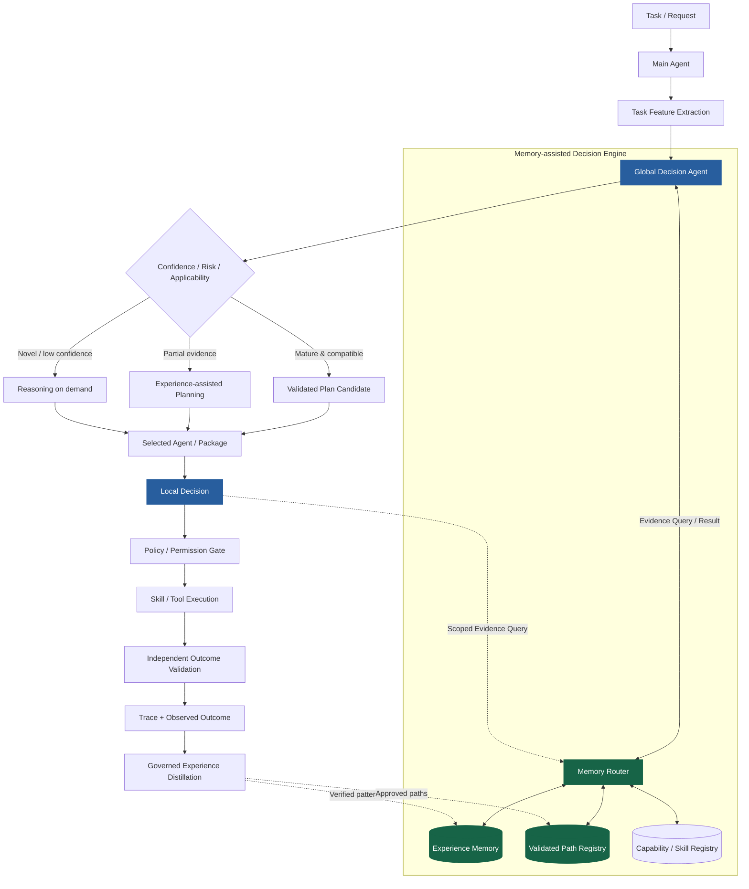

### 2.10.3 兩階段信心與初始路由（Mermaid）

**Stage 1 — Retrieval Opportunity Confidence**：由 Task Signature、Input Schema、已知類型／候選索引、任務限制等**輕量訊號**判斷「是否值得優先查成熟路徑」，不是對某條尚未取回的 path 作成功保證。

**Stage 2 — Path Applicability / Execution Confidence**：Memory Router 回傳具體候選後，由 Decision Agent 結合任務條件、資料來源、已觀測成功／失敗證據、樣本量、版本／schema 相容、權限、資料新鮮度、風險與 validator 做 final choice。未取得足夠證據時不得跳過規劃。

決策成熟度僅用作研究概念：`D-Mature`（可優先查 validated path）、`D-Assisted`（參考歷史後重新規劃）、`D-Explore`（無合適經驗、需要探索）。**不得與既有 §2.8 Skill Tier L1/L2/L3 混淆**。初期分類器只做候選 routing，不能僅靠高相似度直接宣告成熟路徑適用。

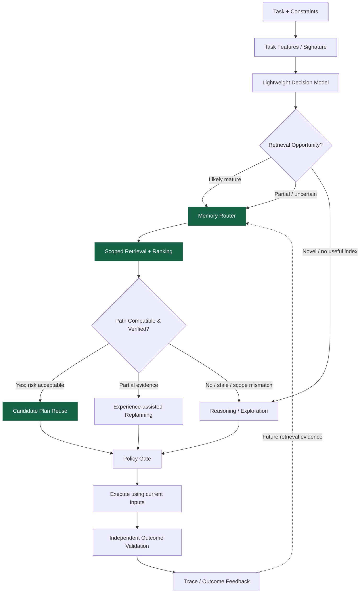

高風險行為即使 path 命中，也仍需 policy / approval；低風險成熟路線可減少大型 LLM 的重複規劃，**不能省略必要執行驗證**。檢索未命中、工具／環境漂移、結果未通過驗證或權限不足時，遵循 Fail Closed 與既有 Recovery / Escalation，不允許「為提高命中率」而放寬安全條件。

### 2.10.4 Memory Router 內部責任（Mermaid）

檢索流程以 **scope / ACL 先限制候選**，後續 ranking 不得逆轉資料可見性。排序可組合 semantic similarity、task/context compatibility、verified outcome、版本／freshness、failure history 與 evidence provenance。相似度是候選訊號，**不是使用權限或已驗證正確性的證明**。

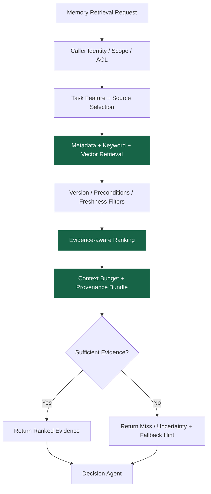

記憶類型可包含 Task Pattern、Decision Evidence、Execution Path、Failure/Recovery 與 Skill/Package Metadata，但**記憶類別為可擴充的通用 taxonomy，不是固定的產業特化資料表**。Memory Router 不負責將不可信原文轉成權威指令；檢索內容應與系統指令隔離，並做 prompt-injection 防護／敏感資料遮罩。

#### Memory Retrieval Security Contract（2026-10-24 治理一致性補強）

Memory Router 必須在 **可信任的 Policy / Data Gateway 邊界內**實施存取控制，不能由 LLM 根據提示自行判斷 ACL。共用檢索服務的 service identity 不是資料授權；調用者的有效權限是經身份驗證、Tenant/Branch/Resource Ownership、父層授權、資料分類、Task-scoped Grant、Grant 有效期限及資源政策交集計算的結果。沿用 docs/MULTI_AGENT_ORGANIZATION_DESIGN.md `4–10：

- **P_child ⊆ P_parent ⊆ P_root**，**G_child ⊆ G_parent ⊆ G_root**；Branch-local by default，跨 Branch/租戶必須有明確可稽核 grant。高階管理 Agent 並不因身分較高而自動取得所有私有資料。
- **可搜尋 metadata 與可讀取 payload 是不同權限**。未授權候選不得出現在向量搜尋候選、Top-K、snippet、LLM context、可識別的結果筆數或一般日誌中。
- **先以授權範圍限制底層查詢，再對每筆回傳證據二次檢查** resource ACL、scope、授權期限、版本、撤銷、驗證狀態及前置條件。若 backend 無法執行安全的 scoped query，不得退回 unrestricted global retrieval；一律 fail closed。
- Embedding、原始 trace、Decision Rationale、Failure Evidence、Cache、Index、Memory Bundle 均繼承來源資料的敏感等級；對取出的內容做 redaction 與 injection isolation，不能當成更高優先序的 system/tool instructions。
- 檢索命中不代表可執行；尚須由 Decision Agent 評估適用性，並由 Runtime Policy Gate 做當次授權。過時／撤銷／污染記憶可保留稽核證據，但不得成為可重用的 active path。

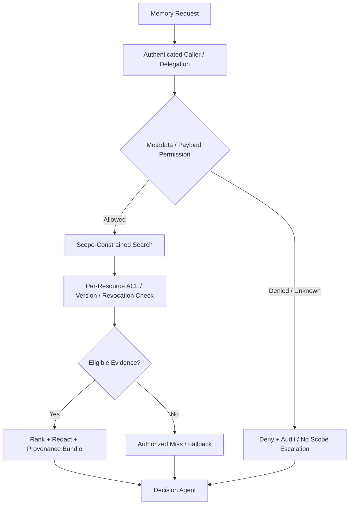

### 2.10.5 Decision / Retrieval / Evidence Interface（初期合約候選）

下列 contract 是 **proposed interfaces**，優先延伸既有 `DecisionModelInterface`、`DecisionEvidence`、`DecisionExperienceRepository`、`ExecutionPathRepository`；不是立即建立新部署單元或改動既有 schema。

| Contract | 職責 | 最小欄位／約束 |
| --- | --- | --- |
| `MemoryRouterInterface.retrieve(request)` | scoped search / ranking / provenance | task_id、trace_id、caller_agent_id、scope、task_signature、candidate_package_refs?、memory_types、budget、retrieval_policy_version |
| `MemoryEvidenceBundle` | 供 Decision Agent 使用的可稽核結果 | evidence_refs、source/type、task/path/version、validation_state、observed_outcome、timestamp、applicability_constraints、rank/confidence?、missing_evidence_flags |
| `DecisionModelInterface.decide(...)` | 根據任務與 evidence 選擇策略 | candidate_set、selected_target、choice_type、confidence?、rationale_summary?、evidence_refs、policy/model version、fallback_reason? |
| `MemoryRetrievalEvidence` | 檢索觀測與基準實驗 | retrieved_ids、filtered_count、ranked_ids、scope、miss_reason?、retrieval_latency、tokens、version、retrieval_cost |
| `ExperienceRepositoryInterface`（邏輯 alias） | 讀取版本化歷史證據 | 既有 DecisionExperienceRepository / ExecutionPathRepository 的 facade；不建立另一份真值來源 |

新增欄位應採 optional、backward-compatible contract，遵守 `task_id` / `trace_id` / `parent_decision_id` lineage；未經測量的 confidence、success probability 或 cost 必須標為 null / unavailable。不得記錄或索取模型私有 chain-of-thought；只保存結構化、可稽核的決策摘要與 provenance。Experience 的成功率必須包含樣本量、失敗／中止紀錄及版本條件，避免 survivorship bias。

#### Decision / Retrieval Contract — Authorization and Evidence（planned）

下列內容是 `2.10.5 既有表格的**增量約束**，不是已實作的介面或資料庫欄位；要延續既有 `DecisionModelInterface`、`DecisionEvidence`、`DecisionExperienceRepository`、`ExecutionPathRepository`，不能建立另一個未同步的權威資料源。

| Logical contract | Minimum semantics |
| --- | --- |
| `MemoryRetrievalRequest` | request_id、task/trace/decision ID、可信 caller principal / agent ID、tenant/branch/resource scope、requested memory types、task signature、retrieval policy version、context budget |
| `MemoryAccessDecision` | PERMIT / DENY / UNKNOWN、metadata_read_allowed、payload_read_allowed、grant/policy ref、reason_code；UNKNOWN = DENY |
| `MemoryEvidenceBundle` | 僅包含授權可見 evidence refs、source/version、validation_state、observed_outcome?、applicability constraints、provenance、redaction state、rank/score? |
| `PathEligibilityDecision` | path ID/version、environment/precondition compatibility、validation/revocation status、risk、ELIGIBLE / INELIGIBLE / UNKNOWN、reason code；eligible **不等於** `can_execute` |
| `MemoryRetrievalEvidence` | request_id、selected authorized refs、hit/miss/denied、index/version snapshot?、stale/revocation reasons、latency、token/cost?、fallback；禁止保存 denied candidates 的敏感名稱或內容 |

Stage 1 confidence 只表示「值得嘗試檢索」，Stage 2 才檢查特定 Path 的適用證據；權限、安全規則永遠是 hard constraints。必須將 MEMORY_ACCESS_DENIED、NO_ELIGIBLE_MEMORY、STALE_VERSION、INSUFFICIENT_EVIDENCE、VALIDATION_FAILED 與正常的 zero-hit 分開；前者不得藉由放寬 scope 重新搜尋。未報告的 probability、token、cost 記為 null / unavailable，Decision Rationale 只存結構化簡要依據，不取用隱藏 chain-of-thought。

Runtime schema 導入須經 additive migration、backward compatibility、index/cache ACL isolation、revocation race、restart read-back 及 cross-tenant negative tests；**不提高 Phase 1 當前退出門檻**。

### 2.10.6 Experience Feedback / Decision Evolution（Mermaid）

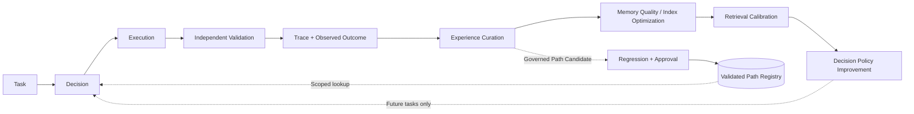

此循環對應既有 **Stage A: LLM Exploration → Stage B: Experience-Assisted Decision → Stage C: Small Learned Decision Model → Stage D: Mature Reusable / Deterministic Path**。只有驗證與治理通過的 path 才能成為可重用資產；評估路由策略改善時，同時追蹤其檢索／維護／訓練成本，不因重複使用而自動認定其正確。

### 2.10.7 研究假設、Baseline 與消融

**H-M1 Retrieval Quality**：在受控相同記憶庫及 scope 下，Task-aware Memory Routing 是否較全域 vector Top-K 提高 relevant / applicable experience 的 Precision@K、Recall@K、MRR、stale-memory rejection，並降低 evidence omission？

**H-M2 Decision Reliability**：在相同模型、可用工具、資料快照、政策、驗證器與計算預算下，Decision Agent + Memory Router 是否提高 Verified Task Success、Correct Decision Consistency、Plan / Tool Selection Accuracy；尤其需要區分「穩定且正確」與「穩定但錯誤」？

**H-M3 Reasoning Cost Amortization**：對 Exact / Near-Similar / Generalized tasks，隨驗證經驗累積，是否減少不必要的 LLM planning、Context Tokens、Total Cost per Successful Task，且維持可靠性、安全與容許的 P95 latency？

- **B0 Direct LLM**：不使用歷史記憶，自主選工具與規劃。
- **B1 Direct LLM + Global Retrieval**：提供相同資料來源的全域 Top-K / RAG，不加入專用 Memory Router。
- **B2 Decision Agent + Simple Retrieval**：既有決策層配一般檢索，測分層的增益。
- **B3 Decision Agent + Task-aware Memory Router**：使用 scoped metadata/hybrid routing、version check 與 provenance。
- **B4 B3 + Validated Path Reuse**：允許成熟路線 fast path，仍經權限與結果驗證。
- **Ablation**：移除檢索、scope-aware filtering（只在隔離合成資料／不洩漏權限的實驗）、failure evidence、version/freshness filter、retrieval ranking、plan reuse、fallback、confidence calibration；控制 context token budget，分別測冷啟動、歷史累積與環境 drift。
- **KPI**：Retrieval Precision@K / Recall@K、Memory Applicability Precision、False Mature-Route Rate、False Reuse Rate、Correct Decision Consistency、Execution Path Entropy、Verified Task Success、Policy Violations、Retries、Cost per Successful Task、P50/P95 Latency、Memory/Routing Overhead。
- **比較原則**：同題重複執行及持有獨立 holdout，凍結或精確記錄 memory snapshots、model/tool/policy versions、backend data；路由與實際成敗分開衡量。情境改變時適當改路是能力而非不穩定；不得使用未驗證的高命中率當作可靠性提升證據。

### 2.10.8 階段整合與非目標

- **Phase 1**：沿用原有 Telemetry/Decision Evidence／Trace contract，僅保留 MADE 所需的未來 optional evidence 欄位候選；**不要求 Memory Router runtime、Path Registry 或新模型**，不得變更既有退出條件。
- **Phase 1.5**：將 provider、sandbox、permission、versioned trace 的現有硬化工作視為前置依賴；不提前擴張自動執行能力。
- **Phase 2（候選）**：在既有 Capability Retrieval / pgvector / Package-scoped lookup 基礎上，提供最小 `MemoryRouterInterface`，先做 deterministic filtering + hybrid retrieval + Version Check + confidence fallback。
- **Phase 3（候選）**：與既有 Decision/Skill/Token 實驗整合 MADE vs Direct LLM、Memory Retrieval、Decision Stability、Governance 與 Cost per Successful Task 的 Baseline／Ablation；使用真實執行證據評估是否值得部署。
- **Non-goals**：不綁定任何特定領域、不預設新的子 Agent 拓撲、不將 Memory Router 視為 Policy Engine、不強制 microservices、不複製歷史資料庫、不將低 context 或路線固定性本身視為成功。

**Design-only boundary：** 本節是架構與實驗候選，尚未獲得 CEAA 實測結果；日後如需實際資料庫 migration、API、服務部署或路由模型訓練，仍須分階段設計與驗證。

---

# 3. 核心設計原則

## 3.1 Capability First

Capability 必須是：

- 可執行
- 可驗證
- 可版本管理
- 可稽核
- 可重用
- 可撤銷

---

## 3.2 Validation Before Activation

任何新能力都不得直接啟用。

必須經過：

```text
Generate
→ Validate
→ Test
→ Report
→ Approval
→ Activate
```

---

## 3.3 Human-Governed Evolution

Agent 可以自主建立能力，但正式啟用仍由管理員治理。

研究版與正式版都保留此機制。

---

## 3.4 Sharing Is Opt-In

未來商品化後：

> **任何 Capability 對外分享都必須由使用者或組織明確選擇。**

預設：

```text
share_enabled = false
```

不得因系統自動演化而自動將使用者能力上傳至公共 Registry。

---

## 3.5 Import Is Also Opt-In

使用者也必須可以決定：

- 完全不取得外部 Capability
- 手動瀏覽與下載
- 接收推薦但手動批准
- 未來選擇受控的自動同步

任何外部能力都不能下載後立即執行。

---

## 3.6 Imported Capability Is Untrusted by Default

即使某個 Capability 已在其他環境驗證：

> **進入新的 Agent 後仍視為未受信任。**

必須重新執行：

```text
Compatibility Check
→ Local Validation
→ Local Test Report
→ Administrator Approval
→ Activation
```

---

## 3.7 Model Independent

底層模型透過 LLM Provider Interface 使用。

---

## 3.8 Infrastructure Independent

核心 Business Logic 不直接依賴：

- NVIDIA
- OpenRouter
- Docker
- PostgreSQL
- Redis
- 特定 Notification Provider

---

## 3.9 Implement Simple, Interface for Complex

現在只做必要功能。

但所有未來重要功能先保留 Interface 與資料結構。

---

## 3.10 Everything Is Versioned

包含：

- Capability
- Schema
- Artifact
- Test Plan
- Test Report
- Approval
- Model
- Prompt
- Policy
- Import
- Export
- Publication

---

## 3.11 Generated Artifacts Are Untrusted by Default

不論是新生成的 Capability、Workflow 或未來 Sub-Agent，只因為成功生成、編譯或通過 Builder 自身測試，都不得因此取得信任。

> **Generation success is not trust evidence. Trust must be earned through independent functional, security, runtime, and governance evidence.**

---

## 3.12 Independent Dual-Agent Cross-Validation

新生成 Artifact 在進入正式核准前，必須至少由兩個彼此獨立的角色進行交叉驗證：

- **Main Agent Review**：確認功能、需求、架構、整合與權限範圍是否符合原始意圖。
- **Audit Agent Review**：以不信任 Artifact 的立場進行安全、權限、資料流、依賴、越權與濫用風險檢查。

兩個 reviewer 的第一次判斷應獨立完成，避免彼此結論造成 anchoring。

---

## 3.13 Fail Closed and Mandatory Human Escalation

交叉驗證採 fail-closed 原則：

```text
AUTO_CONTINUE
iff
Main Review = PASS
AND
Audit Review = PASS
```

以下任一狀態都必須停止自動流程：

- FAIL
- ERROR
- UNKNOWN
- timeout
- reviewer disagreement

並立即產生 Validation Incident，通知 Human Administrator 進行確認。

> **任何一方沒有明確 PASS，都不得自動進入啟用流程。**

安全驗證失敗不得因功能驗證成功而被多數決覆蓋。

---

# 4. 高階系統架構

本節描述 **CEAA 通用目標架構（logical target architecture）**；不表示圖中每個 Agent、Package、Router、Registry、Gateway 已具備 runtime。最小執行基礎與分階段導入限制仍以 `58–60、`71 及 DEV_PLAN / PROJECT_STATUS 為準。

### 4.1 Task → Decision → Execution → Evidence（Mermaid）

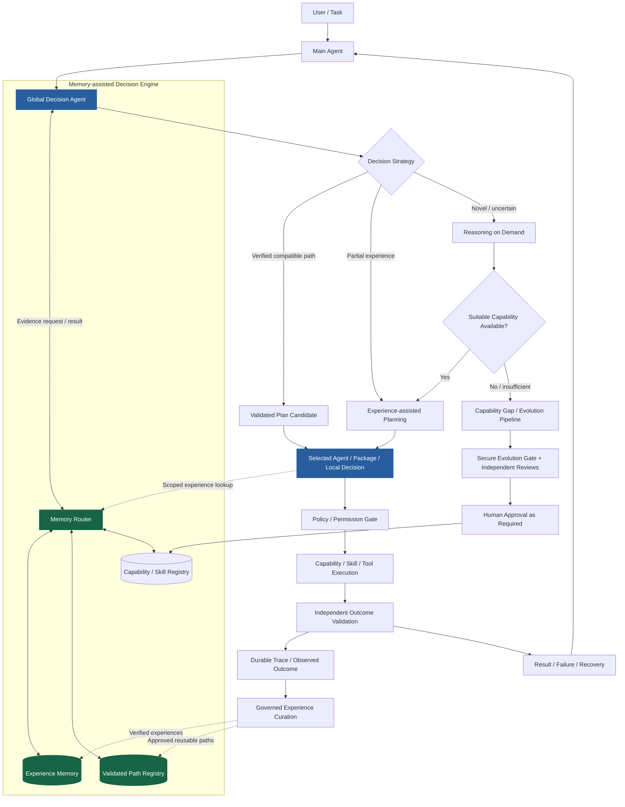

**責任分離：** Global Manager 決定候選 Agent / Package 與跨包策略，Local Decision 決定受限的 Skill / Tool / Workflow；Memory Router 只提供符合 scope 的歷史證據，不接管決策／權限／驗證。首次任務可走 Reasoning / Gap 路線；成熟任務只在條件相容時走 fast path。圖中的 Capability Evolution 註冊／啟用為簡化表述，完整 Secure Evolution Gate、Testing、Report、Policy、Human Escalation、Activation 順序見 `8A、`13、`17–26；**新產物不得因完成 review 就直接啟用**。

### 4.2 Capability Gap → Governed Evolution（Mermaid）

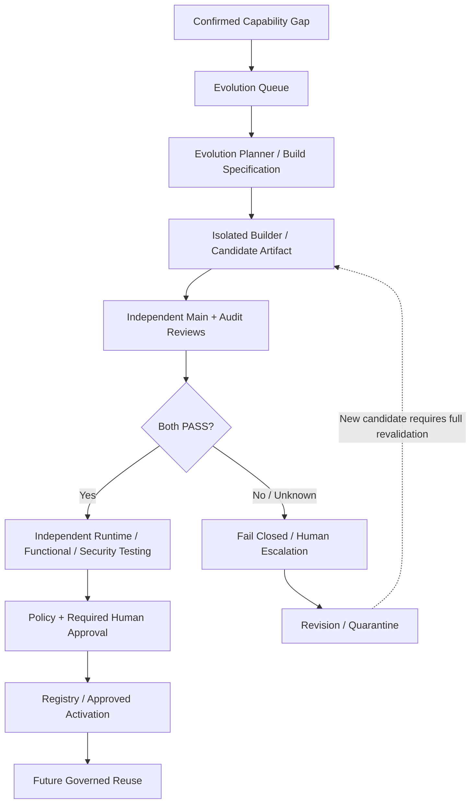

本圖保持原有 Capability Generation 的功能主線；**只有 Capability / Agent Artifact 的新建或更新進入完整 Evolution Gate，已核准且條件相容的執行計畫重用不等於重新生成 Artifact**。任何執行仍受其獨立 Policy Gate 與必要驗證限制。

### 4.3 未來商品化擴充（維持原先預留）

```text
                  Local Capability Registry
                          │
             ┌────────────┴────────────┐
             │                         │
        Export / Publish          Import / Discover
             │                         │
             ▼                         ▼
      Sharing Gateway       Capability Acquisition
             │                         │
             └──────────┬──────────────┘
                        ▼
              Shared Capability Registry
```

此區目前只保留設計，不列入研究 MVP。分享預設關閉，匯入需明確同意及本地驗證；不得將 Experience Memory / raw enterprise data 當成可自動分享資產。

---

# 5. Main Agent Service

Main Agent 是任務入口與結果責任主體，不是每次都直接搜尋完整 Capability 集合、獨自生成 Workflow 或自行重算所有子 Agent 的局部決策。現行 Phase 1 runtime 與規劃中的 Global Manager / Package-local Decision 須明確區分。

### 主要責任

- 理解任務目標、當前輸入、限制、風險與成功判準；建立可關聯的 task / trace identity。
- 透過既有或未來的 Decision Layer，選擇合適的 Capability、Agent、Package、規劃／記憶檢索路徑；無可靠歷史時允許正常推論。
- 在需要歷史證據時，透過 **Memory Router 的 scoped retrieval** 取得候選經驗；不得將記憶命中等同權限或正確性。
- 協調現有 Capability Executor、Local Decision / Tool Execution（分階段導入），確保實際執行遵守 Policy / Permission Gate。
- 評估經獨立驗證的 Outcome，回報成功、失敗、Gap 或 Recovery Context；將可稽核 Decision / Execution Evidence 寫入 Telemetry。
- 對缺少或不足的 Capability 建立 Gap，交由受治理的 Evolution Pipeline，而非自行修改 active capability。

### 邊界與權限

Main Agent 不具有 **直接修改／啟用／發布 Capability**、跨 Scope 存取 Memory、跳過 Independent Validation、替 Human Administrator 核准新 Artifact 等權限。Global Decision 只負責候選範圍與路由策略；Local Decision 在父層授權範圍內處理細部執行，不提升權限。跨分支讀取與遞迴子 Agent 的有效授權，遵循 docs/MULTI_AGENT_ORGANIZATION_DESIGN.md 的既有治理不變量。

**Status:** Phase 1 的 Main Agent / Capability Executor 是現有核心基礎；Global/Local Decision、Package Routing 與 MADE 是未來分階段整合，**尚未全部實作或驗證**。

---

# 6. Capability Gap Detector

主要 Gap 類型：

- Missing Capability
- Insufficient Capability
- Integration Gap
- Reliability Gap
- Efficiency Gap
- Safety Gap

Gap 成立後建立：

**CapabilityGap Record**

並送往 Evolution Queue。

---

# 7. Evolution Queue

初期：

- PostgreSQL

未來：

- Redis
- RabbitMQ
- Kafka

核心只依賴：

```text
QueueInterface
```

---

# 8. Evolution Service

主要流程：

1. 讀取 Capability Gap
2. 分析 Failure Record
3. 搜尋現有能力
4. 搜尋必要知識
5. 產生解法
6. 建立 Candidate Capability
7. 建立基礎 Test Specification
8. 送交 Validation
9. 根據測試回饋 Revision
10. 完成後交由 Registry 管理

Evolution Service 無權直接 Activate 或 Publish。

---

# 8A. Evolution Construction and Secure Verification Pipeline

本節補足 CEAA 從「已確認缺少 Skill / 需要建立 Sub-Agent」到「真正產生可驗證程式 Artifact」之間的 execution architecture。

核心責任分離：

```text
Main Agent
= 定義需要什麼

Evolution Planner
= 決定要建立哪種 Artifact 與產生 Build Specification

Code Evolution Runtime / Builder Agent
= 實際閱讀 Repository、修改程式、建立測試、執行除錯

Main + Audit Cross-Validation
= 獨立確認功能正確性與安全性

Policy / Human Governance
= 決定是否允許正式進入 Registry / Activation
```

完整流程：

```text
Capability Gap / Agent Gap Confirmed
            ↓
      Evolution Planner
            ↓
      Build Specification
            ↓
     Code Evolution Runtime
            ↓
   Ephemeral Builder Agent
            ↓
Inspect → Plan → Code → Test → Debug → Revise
            ↓
      Candidate Artifact
            ↓
================================================
          Secure Evolution Gate
================================================
      ↓                     ↓
Main Agent Review       Audit Agent Review
      └──────────────┬──────────────┘
                     ↓
              Cross-Validation
                     ↓
          ┌──────────┴──────────┐
          │                     │
     PASS + PASS            Anything Else
          │                     │
          ▼                     ▼
 Independent Runtime       BLOCK AUTOMATION
 Testing / Security              ↓
          │               Human Admin Alert
          │                     ↓
          │             Review / Revision
          │                     ↓
          └────────────── Full Revalidation
                     ↓
                 Policy
                     ↓
             Human Approval
                     ↓
           Registry / Activate
```

## 8A.1 Build Specification

Main Agent 不直接要求 Builder 自由發揮，而應先產生結構化 Build Specification，作為 Main Agent 與 Builder Runtime 之間的契約。

至少應描述：

```text
build_id
artifact_type
goal
inputs
outputs
required_interfaces
allowed_dependencies
allowed_tools
forbidden_actions
acceptance_criteria
resource_budget
target_repository
base_revision
requested_permissions
```

## 8A.2 Code Evolution Runtime

Code Evolution Runtime 是可替換的 software-engineering execution layer。

介面方向：

```text
CodeBuilderRuntime
├─ Pi 1.x Builder Adapter           (preferred evaluation candidate)
├─ OpenCode Builder Adapter         (alternative candidate)
├─ Codex-like Builder Adapter
├─ Native / Other Coding Agent Adapter
└─ Future Local Builder Adapter
```

CEAA 核心不得綁死單一 coding-agent framework。

**技術候選（尚未選定）：** Pi 1.x 與 OpenCode 均可作為 Phase 1.5 的 Builder Runtime reference implementation。OpenCode 以 SDK / HTTP server / coding agent / sub-agent 能力作為候選整合路徑；實際支援的 session、model switching、tool permission、trace、usage 與 isolation 行為必須以固定版本進行 adapter compatibility test。

候選選型應在相同 task set、provider/model、budget、workspace policy 下比較：Skill / AgentArtifact 建立成功率、first-pass tests、修復迭代、token/cost、latency、API/SDK integration overhead、recoverability、audit provenance 與 sandbox enforcement。不得因某 runtime 自帶 reviewer / agent 權限設定就跳過 CEAA 的 Main/Audit 獨立驗證、Docker sandbox、Policy Engine 或 Human Approval。

**Status: Technology candidate only — not integrated or validated.**

Builder 的典型循環：

```text
Inspect Repository
→ Plan
→ Edit Code
→ Write / Update Tests
→ Run Tests
→ Observe Failure
→ Revise
→ Repeat Until Exit Condition
```

Builder 必須受 max iterations、runtime、token / cost budget、test-run budget 與 sandbox policy 限制。

## 8A.3 Ephemeral Builder and Isolated Workspace

Builder 預設應為 ephemeral，不直接操作 production branch、production registry、真實 credential 或不受限資料。

建議執行邊界：

```text
Base Revision
    ↓
Temporary Git Branch / Worktree
    ↓
Isolated Workspace / Sandbox
    ↓
Builder writes candidate only
```

典型權限：

```text
repository.read       = allow
workspace.write       = allow
run.tests             = allow

git.push.main         = deny
registry.activate     = deny
production.db.write   = deny
raw.credentials       = deny
```

## 8A.4 Candidate Artifact Contract

Builder 的輸出不是自然語言宣告「完成」，而是版本化 Candidate Artifact 與完整 BuildResult。

至少包含：

```text
source / git diff / commit
manifest
tests
dependency changes
build log
test results
known limitations
security notes
builder provenance
model / provider provenance
resource usage
```

Skill 生成主要產生 CapabilityArtifact；未來 Sub-Agent 生成主要產生 AgentArtifact。

Sub-Agent 應優先組合已驗證 Capability；只有缺少必要能力時才遞迴觸發 Skill Generation，而不是每次從零重寫所有功能。

## 8A.5 Independent Main Agent Review

Main Agent Reviewer 主要回答：

- 是否真正補上原始 Gap
- 是否符合 Build Specification
- 是否遵守架構與介面
- 是否引入不必要功能或依賴
- 是否要求超出需求的權限
- 是否與既有 Capability / Agent 重複
- 是否能正確整合回原始任務流程

Main Agent Review 不具有單獨放行權。

## 8A.6 Independent Audit Agent Review

Audit Agent 必須以 adversarial / untrusted-artifact 立場檢查：

- privilege escalation
- unauthorized tool or data access
- cross-branch access
- credential / secret exposure
- dangerous process / shell execution
- unsafe network behavior
- data exfiltration
- dependency / supply-chain risk
- persistence outside approved scope
- prompt / tool injection paths
- permission bypass through capability composition
- recursive child-Agent privilege bypass

Audit Agent 不得因 Main Agent 認為功能正確而降低安全門檻。

## 8A.7 Frontier-Model Verification

高風險語意驗證可路由到前沿模型，特別是需要理解 control flow、data flow、permission boundary、tool chaining、prompt behavior 與 indirect privilege escalation 的情況。

推薦原則：

```text
Builder
→ coding-specialized / cost-efficient model

Main Functional / Architecture Review
→ strong frontier model

Audit Security Review
→ independently invoked strong frontier model
```

若可行，Main Reviewer 與 Audit Reviewer 應採不同 provider / model family；若使用同一模型，也應使用獨立 inference、不同 system role 與隔離 context。

模型驗證不能取代 deterministic security controls。

## 8A.8 Deterministic + Semantic Security

Secure Evolution Gate 應組合兩類 evidence：

```text
Deterministic Security
+
Semantic Security Review
```

Deterministic evidence 可包含：

- unit / integration / regression tests
- lint / type checks
- SAST
- dependency vulnerability scan
- secret scan
- policy assertions
- sandbox execution
- filesystem diff
- network observation
- resource limits

Semantic review 則由強模型分析 intent、architecture、control flow、data flow、side effects、permission boundaries 與 Agent behavior。

## 8A.9 Security Challenge Generation

Audit Agent 不只閱讀程式，也應能產生 adversarial test cases，再交由 sandbox / testing runtime 執行。

候選案例包括：

- malformed input
- prompt injection
- unauthorized file access
- cross-branch access
- privilege escalation
- secret probing
- network exfiltration
- resource exhaustion
- unsafe tool chaining
- recursive delegation abuse

Audit Agent 因此同時扮演 Security Reviewer 與 Adversarial Test Generator。

## 8A.10 Mandatory Human Escalation

Main Agent 與 Audit Agent 的交叉驗證決策矩陣：

| Main Review | Audit Review | System Action |
|---|---|---|
| PASS | PASS | Continue to remaining tests / approval |
| PASS | FAIL | Block + Human Admin Notification |
| FAIL | PASS | Block + Human Admin Notification |
| FAIL | FAIL | Block + Human Admin Notification |
| ERROR / UNKNOWN / TIMEOUT | any | Block + Human Admin Notification |
| any | ERROR / UNKNOWN / TIMEOUT | Block + Human Admin Notification |

強制規則：

> **No generated artifact may proceed automatically unless both the Main Agent and Audit Agent independently return PASS. Any FAIL, ERROR, UNKNOWN, timeout, or disagreement triggers mandatory human review.**

Human Administrator 可採取：

- Reject
- Request Revision
- Mark Finding as False Positive with recorded justification
- Quarantine

前期設計不提供繞過 Secure Evolution Gate 的 unrestricted Force Activate。

若 Human 判定為 false positive，仍應記錄理由並重新執行完整 validation；Human decision 不直接取代重新驗證。

## 8A.11 Validation Incident Report

任何交叉驗證異常都必須建立可稽核 Incident Record，至少保存：

```text
artifact_id / version
build_id
requested_by
builder identity / model
main review result / evidence
audit review result / evidence
failure category
affected permissions / data
code diff / artifact hash
test evidence
recommended action
human decision
revision lineage
timestamps / trace_id
```

Notification Service 必須支援至少以下事件：

```text
ValidationFailure
CrossValidationDisagreement
SecurityFinding
PolicyViolation
ArtifactQuarantined
HumanReviewRequired
```

## 8A.12 Revision Requires Full Revalidation

任何 Builder 修正都產生新的 Artifact version，並重新執行 Main Review、Audit Review、deterministic tests 與必要的 adversarial tests。

不得只重跑先前失敗的單一檢查。

```text
Candidate v1
→ Finding
→ Revision
→ Candidate v2
→ Full Secure Evolution Gate
```

## 8A.13 Future Sub-Agent Construction

未來 Agent Gap 已確認後，可共用相同 Code Evolution Runtime，但輸出為 AgentArtifact。

AgentArtifact 應至少包含：

```text
Agent Manifest
Role / Goal / Responsibility
System Instructions
Capability Bindings
Tool Bindings
Model Policy
Memory Policy
Data Scope
Permission Scope
Delegation Policy
Child Creation Policy
Resource Budget
Tests / Evaluation
Lifecycle Policy
```

Sub-Agent Secure Evolution Gate 除一般程式安全外，還必須證明：

```text
P_child ⊆ P_parent ⊆ P_root
G_child ⊆ G_parent ⊆ G_root
```

並驗證無法透過 Tool chaining、Capability composition、Data Gateway 或再建立 child Agent 間接繞過上述 ceiling。

---

## 8A.14 Existing Plan Reuse vs Artifact Evolution（2026-10-24 治理一致性補強）

**已核准計畫的執行**與**新能力／新版本的生成或改寫**必須分開治理。`2.9–2.10 的 Memory Router 只提供已授權的歷史證據；Decision Agent 選擇路徑不能取代 Runtime Policy，也不能自行批准新增 Artifact。

| Situation | Enforcement | Full Secure Evolution Gate |
| --- | --- | --- |
| 使用現有 active、已驗證且版本相容的 Capability / Execution Path | 當次身份、scope、版本、precondition、risk、`can_execute`、必要 human approval 與結果驗證 | **不需為每次重用重新進行 Artifact Generation Review** |
| 在既有核准 manifest 的允許範圍內調整參數 | 檢查 schema、permission、side effects、版本、run-time limits；仍須執行授權 | 未改變受驗證語意者不需；越界視為新候選 |
| 建立／修改 Skill、程式碼、AgentArtifact、Workflow semantics、執行 Path 版本或擴張權限 | 新候選、版本化、Sandbox / Regression、獨立 Main/Audit Review、Policy、Human Approval（適用時） | **必須通過適用的完整驗證及啟用流程** |
| 無授權、證據不可信、版本失效、前置條件不符或路徑遭撤銷 | Fail closed；重新規劃／人工升級，禁止自動使用失效 Path | 不能靠 Router 命中繞過 Gate |

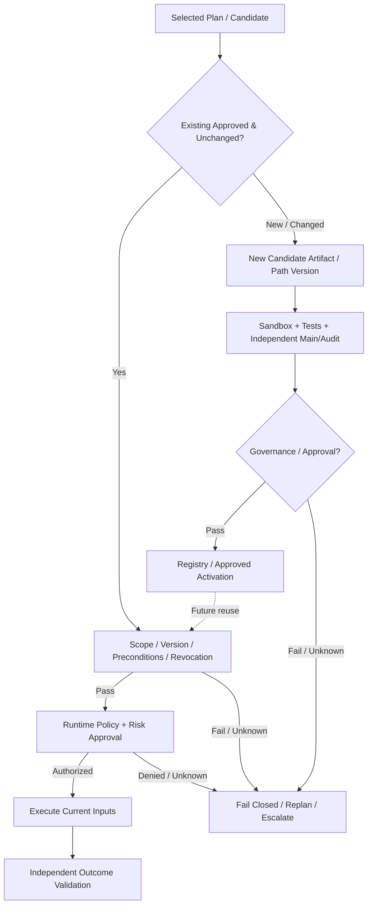

**界線不變**：重用不能繞過執行權限與結果驗證；新 Artifact 不能繞過完整 Secure Evolution Gate。Runtime 成功 trace 只代表觀測結果，不會自動將未核准候選變成 active reusable path。修復流程 `55.1 也遵守此分類。

---

# 9. Capability 定義

Capability 是：

> **可以被 Agent 重複執行，並具有明確輸入、輸出、依賴、風險、驗證與版本資訊的能力單元。**

可能形式：

- Python
- API
- Workflow
- Tool Sequence
- Agent Workflow
- Container
- Domain Procedure

---

# 10. Capability Schema

至少包含：

```text
schema_version
capability_id
capability_version

name
description

tenant_id
owner_id
organization_id
scope

task_family

inputs
outputs
preconditions

dependencies
implementation

validation_requirements
safety_requirements

compatibility
trust_level

status

sharing_policy
distribution_metadata

created_at
updated_at
```

---

# 11. Capability Identity

使用穩定 ID：

```text
CAP-000001
```

Identity 與名稱、版本、儲存位置分離。

---

# 12. Capability Versioning

至少分為：

```text
schema_version
capability_version
```

未來 Sharing Registry 也必須保留完整版本。

---

# 13. Capability Lifecycle

```text
Draft
 ↓
Candidate
 ↓
Validating
 ↓
Testing
 ↓
Tested
 ↓
Pending Approval
 ↓
Approved
 ↓
Active
 ↓
Deprecated
 ↓
Revoked
 ↓
Archived
```

外部能力另外增加：

```text
Discovered
 ↓
Downloaded
 ↓
Imported
 ↓
Local Validation
 ↓
Local Testing
 ↓
Pending Approval
 ↓
Active
```

---

# 14. Capability Executor

統一透過：

```text
CapabilityExecutor
```

未來支援：

- PythonExecutor
- APIExecutor
- WorkflowExecutor
- ContainerExecutor
- AgentExecutor
- PluginExecutor

---

# 15. Capability Composition

Capability 可依賴其他 Capability。

例如：

```text
CSV Reader
+
Analyzer
+
Report Generator
        ↓
Automated Analysis Capability
```

因此保留：

```text
dependencies
child_capabilities
composition_type
```

---

# 16. Capability Registry

Registry 管理：

- Identity
- Version
- Status
- Ownership
- Scope
- Validation
- Test Report
- Approval
- Trust
- Compatibility
- Dependency
- Sharing Policy
- Publication State
- Revocation

---

# 17. Capability Testing Agent

Testing Agent 與 Evolution Agent 分離。

Evolution：

> 建立能力。

Testing：

> 嘗試證明能力可能在哪裡失敗。

---

# 18. Autonomous Test Plan

測試類型包括：

- Functional
- Boundary
- Failure
- Regression
- Generalization
- Safety
- Performance

---

# 19. Validation Service

接口：

```text
validate(
    capability,
    test_suite,
    validation_context
) -> ValidationResult
```

第一版 Sandbox：

**Docker**

---

# 20. Capability Test Report

每個 Capability Version 必須產生：

```text
test_report.json
test_report.md
```

內容包含：

- Test cases
- Pass rate
- Failed cases
- Generalization
- Regression
- Safety
- Performance
- Known limitations
- Risk level
- Recommended action

---

# 21. Capability Artifact

建議：

```text
CAP-000001/
├── manifest.yaml
├── implementation/
├── tests/
├── test_plan.yaml
├── test_report.json
├── test_report.md
├── validation/
├── changelog.md
└── README.md
```

---

# 22. Human Approval Gate

新能力完成測試後：

```text
Pending Approval
```

管理員可以：

- Approve
- Reject
- Request Revision
- Approve With Restrictions

---

# 23. Notification Service

保留：

```text
NotificationService
```

Provider 可包括：

- Console
- Email
- Webhook
- Slack
- Teams
- Mobile Push

新能力 Ready for Review 必須通知管理員。

---

# 24. Approval Service

接口：

```text
request_approval()
approve()
reject()
request_revision()
approve_with_restrictions()
```

Notification 不具有 Activation 權限。

---

# 25. Event Contract

核心事件：

```text
CapabilityGapCreated
CapabilityGenerated
BuildSpecificationCreated
BuilderStarted
CandidateArtifactCreated
MainReviewCompleted
AuditReviewCompleted
CrossValidationCompleted
HumanReviewRequired
ValidationIncidentCreated
ArtifactQuarantined

ValidationStarted
ValidationCompleted

CapabilityTestingStarted
CapabilityTestingCompleted

CapabilityReportGenerated

CapabilityReadyForReview
CapabilityApproved
CapabilityRejected

CapabilityActivated
CapabilityDeprecated
CapabilityRevoked
```

未來 Sharing 新增：

```text
CapabilityExportRequested
CapabilityExported

CapabilityPublishRequested
CapabilityPublished
CapabilityPublishRejected

CapabilityDiscovered
CapabilityDownloadRequested
CapabilityDownloaded

CapabilityImportStarted
CapabilityImported

CapabilityLocalValidationStarted
CapabilityLocalValidationCompleted

SharedCapabilityRevoked
SharedCapabilityUpdateAvailable
```

---

### 25.1 Planned Decision / Memory Events

以下是通用的 **logical event vocabulary**，不是 Phase 1 runtime 已完成或強制新增的資料表：

```text
DecisionRouteSelected
MemoryRetrievalRequested
MemoryAccessAllowed
MemoryAccessDenied
MemoryRetrievalCompleted
MemoryRetrievalMissed
MemoryEvidenceRejected
PathEligibilityEvaluated
ValidatedPathReuseSelected
ValidatedPathReuseRejected
ExecutionPlanReplanned
ExperienceCurationProposed
ExperienceCurationApproved
```

候選 event envelope：event_id、type/version、timestamp、tenant_id、task_id、trace_id、decision_id?、parent_decision_id?、retrieval_request_id?、caller_agent_id?、path_version?、policy_version?、status、reason_code?、authorized evidence refs?。區分 DENIED／MISS／STALE／INELIGIBLE／VALIDATION_FAILED；不儲存敏感原文、未授權候選或私有 chain-of-thought。**Phase 1 仍先完成既有 Telemetry Schema v1 的 wiring 與退出條件。**

---

# 26. Audit Trail

需記錄：

- Generate
- Build Specification
- Builder execution / revision
- Candidate Artifact creation
- Main Agent Review
- Audit Agent Review
- Cross-Validation decision
- Human Escalation / Incident decision
- Validate
- Test
- Report
- Notify
- Approve
- Activate
- Import
- Export
- Publish
- Download
- Update
- Rollback
- Revoke

---

### 26.1 Memory Retrieval / Path Reuse Audit（planned）

未來應能追蹤 caller identity、effective scope、allow/deny/unknown、policy version、memory retrieval、path eligibility、fallback、當次 execution authorization 與獨立 outcome。應可區分「沒查到」「因權限拒絕」「記憶不相容」「選錯路徑」「執行失敗」，但不能因稽核目的暴露未授權 evidence ID、原始敏感 payload、token／憑證或 LLM 私有 chain-of-thought。Audit 寫入失敗不可使原本的 DENY 變成 ALLOW。

---

# 27. Service Layer

建議：

```text
MainAgentService
GapDetectionService
EvolutionService
EvolutionPlannerService
CodeBuilderService
SecureEvolutionGateService
CrossValidationService
ValidationIncidentService

CapabilityService
CapabilityExecutionService

ValidationService
TestingService

PolicyService
ApprovalService
NotificationService
```

未來保留：

```text
CapabilityImportService
CapabilityExportService
CapabilityPublishingService
CapabilityDiscoveryService
CapabilitySyncService
```

這些目前只定義邊界，不實作完整功能。

---

# 28. LLM Architecture

```text
Agent
 ↓
Internal LLM Gateway
 ↓
Routing Policy
 ↓
LiteLLM
 ├─ NVIDIA NIM
 ├─ OpenRouter
 └─ LocalLLMProvider
```

---

# 29. Local LLM Readiness

預留：

```text
LocalLLMProvider
```

未來可接：

- Ollama
- llama.cpp
- vLLM
- LM Studio

---

# 30. Storage Separation

### Metadata

PostgreSQL

### Artifact

Git + Filesystem

### Vector

pgvector

### Test Report

Git / Filesystem

### Experiment

PostgreSQL → MLflow

未來 Shared Registry 為獨立服務。

---

# 31. Capability Scope

保留：

```text
private
local
organization
global
```

### Private

只屬於特定使用者。

### Local

只屬於目前 Agent。

### Organization

組織內共享。

### Global

允許未來發布至共享 Registry。

Scope 本身不代表已經允許分享。

---

### Capability Scope and Memory Scope Are Separate

上述 private / local / organization / global 定義的是 Capability 的使用／發布範圍，**不代表**可讀取或發布其 Execution Trace、Decision Memory、Embedding 或私有歷史。即使 Capability 將來可以 global 分享，相關 local memory 仍預設不共享。

Memory Router 的有效讀取範圍須同時通過已驗證的 caller identity、tenant / branch ownership、resource ACL、資料分類、parent delegation、task-scoped grant、期限／撤銷及政策檢查；Branch-local by default，跨 Branch 需有明確授權。Root / Manager 亦不得僅憑層級無限制取得所有 branch 私有內容。依 docs/MULTI_AGENT_ORGANIZATION_DESIGN.md `4–10；**現階段為設計契約，不代表目前 default-tenant mock runtime 已做到跨租戶隔離**。

---

# 32. Sharing Policy

新增：

```text
sharing_policy
```

可能狀態：

```text
private_only
manual_share
organization_only
global_opt_in
```

預設：

```text
private_only
```

---

# 33. Capability Upload / Import — Future Reserved

## 狀態

**Reserved for Future Development**

研究 MVP 不實作完整 Marketplace。

但現在必須保留：

```text
CapabilityImportService
```

未來允許使用者：

> 將外部 Capability 加入自己的 Agent。

來源可能包括：

- Local file
- Organization Registry
- Global Capability Registry
- Trusted partner
- Capability Marketplace

---

# 34. Capability Upload Package

未來 Capability 可採標準套件：

```text
capability-package/
├── manifest.yaml
├── implementation/
├── tests/
├── test_report.json
├── test_report.md
├── dependencies.lock
├── signature.json
└── README.md
```

未來可封裝為：

```text
.cap
```

或其他標準格式。

目前只保留 Packaging Interface。

---

# 35. Imported Capability 安全流程

任何外部 Capability：

```text
Downloaded
     ↓
Signature Check
     ↓
Manifest Validation
     ↓
Dependency Inspection
     ↓
Compatibility Check
     ↓
Static Safety Check
     ↓
Local Sandbox Validation
     ↓
Testing Agent
     ↓
Local Test Report
     ↓
Administrator Approval
     ↓
Active
```

因此：

> **別人的測試報告只能作為參考，不能取代本機驗證。**

---

# 36. Capability Publish / Sharing — Future Reserved

新增：

```text
CapabilityPublishingService
```

未來使用者可以選擇：

> 是否願意把自己的 Agent 新學到的能力分享出去。

預設：

```text
publish = false
```

---

# 37. Publishing Flow

未來可能流程：

```text
Local Active Capability
       ↓
User Selects Share
       ↓
Publish Request
       ↓
Privacy / Secret Scan
       ↓
Environment Neutralization
       ↓
Generalization Check
       ↓
Security Review
       ↓
Package Generation
       ↓
Signature
       ↓
Shared Capability Registry
```

---

# 38. Environment Neutralization

Capability 不可以把使用者環境直接分享出去。

發布前需要移除：

- Local paths
- Hostnames
- IP addresses
- Credentials
- Tokens
- Internal API URLs
- Customer IDs
- Private configuration
- Private datasets

因此 Future Publishing Pipeline 必須包含：

**Sanitization / Neutralization**

---

# 39. Sharing Consent

分享必須有明確 Consent Record：

```text
consent_id
user_id
capability_id
capability_version
sharing_scope
approved_at
revocable
```

使用者未同意時，不得發布。

---

# 40. Capability Discovery — Future Reserved

未來新增：

```text
CapabilityDiscoveryService
```

Agent 或使用者可以搜尋：

```text
"What capabilities exist for CSV repair?"
```

Registry 回傳：

- Capability
- Version
- Description
- Publisher
- Trust Score
- Validation Count
- Supported Environment
- Dependencies
- Risk Level

---

# 41. External Capability Recommendation

未來 Main Agent 遇到 Gap 時，可以：

```text
Local Search
      ↓
No Suitable Capability
      ↓
Ask Shared Registry
      ↓
Candidate External Capability
      ↓
Recommend to User
```

但不能直接安裝。

必須由使用者確認：

```text
Would you like to acquire this capability?
```

---

# 42. Capability Acquisition Modes

未來商品化可提供：

### Mode A — Isolated

```text
External Capability = Disabled
Sharing = Disabled
```

適合高安全企業。

### Mode B — Manual

使用者手動：

- Search
- Download
- Share

### Mode C — Recommended

Agent 可以推薦，但使用者批准。

### Mode D — Organization Managed

由公司管理員控制內部 Capability Registry。

### Mode E — Managed Sync

未來成熟後可以允許：

> 特定 Trusted Capability 自動取得更新。

但仍受 Policy Engine 控制。

---

# 43. Capability Update

外部 Capability 未來可能有：

```text
CAP-001
v1.0
 ↓
v1.1
 ↓
v2.0
```

Local Agent 必須能選擇：

- Ignore
- Review Update
- Test Update
- Approve Update
- Rollback

不能強制自動更新。

---

# 44. Shared Capability Revocation

若 Global Registry 發現：

- Security issue
- Malware
- Dangerous behavior
- Severe bug

可發布：

```text
CapabilityRevocationNotice
```

Local Agent 應：

1. 提醒管理員
2. 標記 affected Capability
3. 停止新任務使用或依 Policy 處理
4. 提供 rollback

---

# 45. Shared Capability Trust Model

未來可建立：

**Capability Trust Score**

依據：

- Publisher reputation
- Validation count
- Cross-environment success
- Regression history
- Security scan
- User feedback
- Revocation history

但 Trust Score 永遠不能替代本機 validation。

---

# 46. Capability Provenance

所有 Capability 必須保留來源：

```text
origin:
    local_generated
    manual_created
    imported
    organization_shared
    global_shared
```

外部 Capability 另外保存：

```text
source_registry
publisher
original_capability_id
original_version
imported_at
```

---

# 47. Fork Capability

使用者取得別人的 Capability 後，可能自行修改。

因此未來支援：

```text
Fork
```

例如：

```text
Global CAP-120
      ↓
Import
      ↓
Local Fork
      ↓
CAP-LOCAL-32
```

保留：

```text
parent_capability_id
parent_version
```

---

# 48. Capability Lineage

未來 Capability 可能形成：

```text
Original
   ↓
Fork
   ↓
Improved
   ↓
Published Variant
```

因此 Registry 應保留：

**Capability Lineage**

這對研究 Agent 的能力演化路徑也有價值。

---

# 49. Capability Marketplace — Future Reserved

正式商品化後，可以進一步演進成：

**Capability Marketplace**

但目前不列入研究開發。

未來 Marketplace 可能支援：

- Free Capability
- Private Capability
- Organization Capability
- Verified Capability
- Vendor Capability

現階段只保留 Architecture Extension Point。

---

# 50. Collective Capability Network

更長期可以形成：

```text
Agent A
  ↓
Learns Capability X
  ↓
User Opt-In Share
  ↓
Global Registry
  ↓
Agent B discovers X
  ↓
User Opt-In Download
  ↓
Local Validation
  ↓
Agent B gains X
```

這形成：

> **Capability-level collective learning**

不需要交換模型權重。

---

# 51. Privacy Boundary

共享的是：

- Capability implementation
- Generic workflow
- Validation metadata
- Compatibility
- Generic tests

不共享：

- Raw user data
- Conversation history
- Enterprise logs
- Credentials
- Internal topology
- Private configuration
- Local memory

---

### Memory / Retrieval Privacy Boundary

Raw execution history、error log、Decision Rationale、Memory Bundle、Embedding、Vector Index、Cache 和其備份都可能包含敏感資料，須沿用來源分類、retention、revocation、redaction 和 access policy。索引化／摘要化不會自動讓資料變成公開；不得以 unrestricted global retrieval 當 fallback。Retrieved text 是 **untrusted data**，不得升格成 system/tool instructions，亦應防範 prompt injection 和 memory poisoning。

能力分享仍須使用者選擇、清洗與本地驗證；私有 Memory／Trace 不應隱含打包輸出。Denied candidates 不進 Top-K、LLM context、snippet、可識別聚合資料或一般 telemetry。

---

# 52. Tenant Readiness

Schema 從第一版保留：

```text
tenant_id
organization_id
owner_id
scope
sharing_policy
```

研究階段使用 default tenant。

---

### Future Memory Delegation / Tenant Inputs

除既有 `tenant_id / organization_id / owner_id / scope`，未來請求可帶 parent/root agent lineage、branch/resource owner、data_classification、delegated_grant_ref、grant expiry、requested_access（metadata 或 payload）及 policy version。這些是 **未來的 logical contract**；不能僅因 API payload 自稱 tenant/agent 身分便放行。可信 Policy / Data Gateway 應做 query-scope 和 resource-level enforcement、撤銷與快取失效檢查；所需 schema migration 須 backward-compatible，不增加現行 Phase 1 退出條件。

---

# 53. Policy Engine

未來增加：

```text
can_import()
can_export()
can_publish()
can_download()
can_sync()
can_share_globally()
```

與既有：

```text
can_generate()
can_validate()
can_execute()
can_activate()
```

整合。

---

### 53.1 Memory / Decision / Execution Policy（planned）

候選 Policy Checks（不是已實作 API）：

```text
can_discover_memory_metadata(caller, resource, task)
can_read_memory_payload(caller, resource, task)
can_delegate_memory_access(parent, child, scope, expiry)
can_reuse_execution_path(caller, path_version, context)
can_execute(caller, capability_or_plan, current_context)
```

區分 **Retrieval Authorization**（是否可讀 metadata／payload）、**Plan Eligibility**（是否可信且相容）、**Execution Authorization**（當次工具／資源、風險與必要 human approval），以及 **Artifact Activation Governance**（新建或修改版本須 `8A Secure Evolution Gate）。Eligible 不等於 Authorized；高路由信心不能蓋過 DENY / UNKNOWN。未授權、撤銷、過期或不相容時要 fail closed，不得切換到更高權限的 Retriever 重試。

---

# 54. Notification 擴展

Future Sharing Events 也使用 Notification Service。

例如：

- External capability available
- Capability update available
- Publication approved
- Publication rejected
- Shared capability revoked
- Organization capability published

---

### Memory Governance Notifications（planned）

Unauthorized retrieval attempts、撤銷 Path 被重用、可疑 memory poisoning、跨 tenant/branch 存取等可做治理告警候選；由 Policy Engine 決定是否通知及是否人工升級，普通的 retrieval miss 不應造成告警風暴。通知使用安全的 reason code / trace ref，不夾帶被拒絕的內容。

---

# 55. Observability Contract

標準 Metadata：

```text
run_id
task_id
agent_id

capability_id
capability_version

experiment_id

model_id
tenant_id
trace_id
```

未來加入：

```text
registry_id
publisher_id
source_capability_id
```

---

### 55.0.1 Memory / Decision Observability（planned）

在既有 run/task/agent/capability/tenant/trace metadata 與 `routing_decisions / execution_observations` 上，後續可逐步增加：

| Logical span | Correlation / observation |
| --- | --- |
| Decision | decision_id、parent decision、candidate set（僅授權）、selected target、model/policy version、routing confidence?、latency |
| Memory Retrieval | retrieval_request_id、caller、authorized scope ref、policy/index snapshot version?、HIT / MISS / DENIED、returned authorized evidence refs?、latency/token/cost? |
| Path Eligibility | path/version、validation state、precondition/version compatibility、revocation、ELIGIBLE / INELIGIBLE / UNKNOWN、reason code |
| Execution / Outcome | pre-execution policy decision、approval_ref?、path reused?、validator version、observed outcome、retry/fallback |
| Curation / Revocation | source trace、validation provenance、approved/rejected state、curation/index version、revocation lineage |

這些欄位需保留 null/unavailable、分辨檢索錯誤／決策錯誤／權限拒絕／驗證失敗、完整成功與失敗母體；不可將敏感 payload、denied candidate、private chain-of-thought 放入一般遙測。**這是設計預留，不要求 Phase 1 現有 SQLite schema v1 已具備所有 spans；Phase 2/3 導入須 migration、契約／隔離測試。** `56 的集中研究指標整合留待第三輪。

---

## 55.1 Failure-driven Self-Recovery Architecture（2026-10-19 設計增補）

**狀態：Approved Design / Planned / Not Implemented。** 本節屬 v1.9 設計基準的增補，延續既有 Manager、Telemetry、Experience Memory 與 Secure Evolution Gate，不代表目前 Runtime 已具備自主診斷或修復功能。

### 目標與架構定位

系統在任務失敗且安全重試達上限後，不立即將整個任務視為不可恢復，而是建立結構化 Failure Episode，由 Failure Analysis Manager 選擇必要的診斷 Agent，定位失敗環節、提出修復候選並通過獨立驗證，最後安全恢復或升級給人類管理員。這形成第四條**研究性演化路徑 Reliability Evolution**，與 Capability / Decision / Performance Evolution 共享 Experience Memory 和 Telemetry。

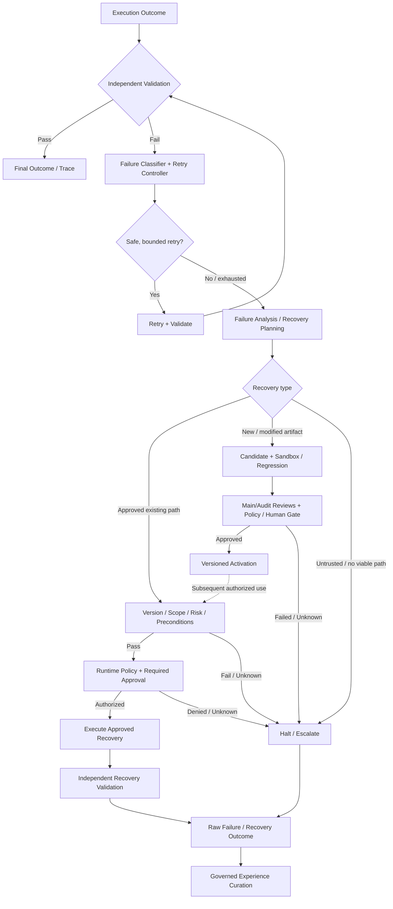

### 分層責任與契約

- **Retry Controller**：區分 transient / semantic / policy / authorization / side-effect / permanent failure；判斷冪等性、是否已部分成功、backoff、retry 次數、deadline 與成本上限。非冪等操作不可盲目重試。
- **Failure Analysis Manager**：依 error taxonomy、歷史經驗、預算與風險，選擇一個或多個專業診斷 Agent；不要求每次啟動全部 Agent。
- **Diagnostic Agents**：Trace、Root Cause、Tool/API、Skill、Environment 等角色只提出可追溯證據與假說；不得因 LLM 自評而認定根因已證實。
- **Repair Planner**：產生版本化 `RecoveryPlan`、候選變更、風險與 rollback/checkpoint；不得直接修改 production。
- **Recovery Gate**：依 `8A.14 區分**既有已核准修復路徑**（每次做權限、環境／版本、前置條件、風險、必要人工核准及獨立結果驗證）與**新建／修改 Recovery Skill 或 Path**（完整 Sandbox、Regression、Main/Audit independent review、Policy／Human Governance）。失效、拒絕、UNKNOWN、timeout 或審查衝突均 fail closed。
- **Experience Memory**：Raw failure/failed repair 全部保留；只有獨立驗證成功且經治理允許的修復流程，才可提升為可重用 Recovery Skill。成功歷史仍需在每次重用前核對 scope、版本、授權與 revocation，不能只因相似度高便直接執行。

Phase 1 的 backend-neutral interface contract：`RetryPolicyInterface`、`FailureAnalysisInterface`、`RecoveryPlannerInterface`、`RecoveryGateInterface`、`RecoveryOutcomeRepository`。資料契約至少包括 `FailureContext`、`RetryDecision`、`RecoveryPlan`、`RecoveryOutcome`，與既有 `execution_traces`、`execution_failures`、`recovery_attempts`、`routing_decisions` 以 task/trace/failure ID 關聯。所有 token、latency、repair cost 與 validation result 都應記錄；不可取得的值保持 unavailable。

### 階段落地

| 階段 | 功能 | 完成判準 |
|---|---|---|
| Phase 1 | Interface / data contracts、failure lineage、bounded retry policy、Mock contract tests；完成既有 telemetry runtime wiring | 能保存失敗→重試→上限→待診斷事件，重啟可查詢；**不需**自主診斷 Agent |
| Phase 1.5 | Real provider、sandbox、policy、gate、audit、checkpoint 與 human escalation hooks | 失敗候選不得繞過治理；unsafe/unknown case fail closed |
| Phase 2 | Single Failure Analysis Agent + Repair Planning MVP、受控修復、curated recovery experience | 能在故障注入任務上產生可驗證診斷、候選修復與安全結案 |
| Phase 3 | 多 Agent 選擇式診斷、experience-aware recovery routing、縱向實驗 | 以獨立 holdout benchmark 驗證品質、成本、恢復與回歸率 |

### 不變的治理限制

Retry、repair cycles、time/cost budget 與 recursive delegation 必須有明確上限；任何恢復均不得提升權限或擴大資料存取；需要處理未知 side effect、重複提交及 rollback。修復 Candidate 必須重新通過完整驗證；高風險操作保留 Human Administrator 核准權。Phase 1 先蒐集原始資料，禁止將未驗證的診斷寫成「成功經驗」。

---

# 56. 研究指標（Cross-Experiment Metric Contract；2026-10-24 第三輪修訂）

本節是 `2.1–2.10、`55.1 與 `60 的 **共用研究指標字典**。所有指標皆屬待實驗驗證的候選 KPI；**Phase 1 的責任仍是將既有 operational history、routing decision、failure/retry 與 token-cost 指標可靠持久化，不能將本節全部指標當成 Phase 1 完成條件**。未實作／無資料的項目明確標記 unavailable，而非填入估算或將未觀察到當作零。

研究問題分成五個可區分的層次：**Capability Evolution**（能否建立並安全重用能力）、**Memory Retrieval**（能否找到有權取得且適用的證據）、**Decision Evolution**（能否正確選擇與必要時放棄重用）、**Execution / Reliability**（能否經獨立驗證真正完成任務）、**Efficiency / Amortization**（完整成本是否下降）。**Routing accuracy、memory hit rate、task success 與 governance pass 不得互相代替**。

### 56.1 共同量測單位、分母與 Outcome Oracle

所有實驗先決定統計單位：`task_id`（最終任務）、`decision_id`（一次路由／決策）、`retrieval_request_id`（一次記憶查詢）、`execution_attempt_id`（一次執行／重試）、`failure_episode_id`（一次符合診斷資格的故障）、`artifact_or_path_version`（版本化演化單位）。同一 task 的多次 retry、LLM 呼叫或 tool steps 不可當成彼此獨立的成功任務樣本；跨組比較應按 task/family/seed 配對。

**Outcome Oracle**：Task Success 只能由事先固定的 acceptance criteria、可重現測試或獨立驗證器確定；不能用模型自評、歷史 success flag、記憶命中或 Approval 記錄取代。評估器／測試資料在正式 holdout 前凍結，記錄 oracle/version、人工歧義處理與未知狀態。

| Metric | 定義／分母（未註明者以 eligible observations 計） |
| --- | --- |
| **Verified Task Success Rate** | 經獨立 oracle 判為成功的任務數 ÷ 所有已提交且納入實驗的任務數；失敗、逾時、預算耗盡、政策拒絕各自報告，**不能從分母默默移除** |
| **Capability Generation Success Rate** | 經完整驗證且取得所需核准的新候選數 ÷ 嘗試生成的候選數；另報告可用版本數、第一次通過率與修正次數 |
| **Validation / Testing / Approval Rate** | 各階段通過數 ÷ 實際進入該階段數；另報告全部候選為分母的 end-to-end conversion，避免只看通過篩選的樣本 |
| **Reuse Rate / Generalization Rate** | 符合適用性、政策與驗證條件的實際重用／泛化成功數 ÷ 定義清楚的 eligible task 數；另報告 attempted / rejected reuse，不把命中視為重用成功 |
| **Regression Rate** | 新／優化版本在既有固定 regression suite 中新出現失敗的案例數 ÷ 可比較既有成功案例數；另以版本為單位報告受影響版本比例 |
| **Repeated Failure Rate** | 同一 normalized failure family 在固定窗口內再次發生的 task/attempt 數 ÷ 同一母體中有機會發生該失敗的 task/attempt 數；須報告時間窗與暴露量 |
| **Policy Violation / Unauthorized Action Rate** | 實際違規動作數 ÷ 可執行動作機會數；若為零，仍報告樣本規模、置信上限及拒絕事件，不宣稱證明「絕對安全」 |
| **Latency** | Task end-to-end P50/P95/P99（如樣本足夠）、Decision / Retrieval / Execution / Validation 的分段時間；逾時與未成功需有明確的 censoring/timeout 規則 |

**Missing Data**：沒有 model confidence、reasoning tokens、provider monetary cost 或驗證結果時分別為 null / unavailable / unknown；不能以 0、PASS 或平均數插補。報告 metrics 的可觀測率、失敗事件 coverage 與不同實驗組的缺失率。

### 56.2 Token、Total Cost 與 Reasoning Cost Amortization

沿用 Phase 1 既有 task / interaction Telemetry，不刪除既有欄位。每次互動／任務應盡可能關聯：`task_id`、`trace_id`、`experiment_id`、`task_family`、`model/provider/version`、`capability/path/version`、`created/reused/revised`、`input_tokens`、`output_tokens`、`reasoning_tokens?`、`total_tokens`、`llm_call_count`、`retry_count`、`latency`、`task_success`。Provider 未提供 reasoning tokens 或可靠費用時記 unavailable，不推估為實測。

依階段區分：

```text
First Encounter / Capability Creation:
  gap detection + planning + code generation + validation
  + testing + revision + audit / approval + artifact maintenance

Experience-Assisted / Plan Reuse:
  initial classification + authorized memory lookup + ranking
  + local/global decision + compatibility checks + execution
  + runtime policy / validation + retry / fallback + memory maintenance

Total Cost (observed or explicitly estimated):
  LLM usage + tool / API + compute + memory index/storage
  + verification + retry/recovery + governance / human review
  + amortized creation / training / curation / maintenance
```

以相同 task sequence、固定計價時間／單位、明確假設與成本可觀測性比較：

```text
Cost per Successful Task (CPST)
  = Total Evaluation-Window Cost / Number of Independently Verified Successful Tasks

Average Cost per Submitted Task
  = Total Evaluation-Window Cost / Number of Submitted Tasks

Token Saving Rate
  = 1 - (Comparable CEAA Total Tokens / Comparable Baseline Total Tokens)

Net Cumulative Saving(N)
  = Cumulative Baseline Cost(N) - Cumulative CEAA Cost(N)

Break-even Reuse Count
  = first N with Net Cumulative Saving(N) > 0
    (report "not reached" if not observed)
```

`CPST` 只有在成功數 > 0 時可計算；成功數為 0 應報 undefined／no successes，並單獨列出總成本和失敗數。**成本與成功率必須一起呈現**，在無等價品質與安全條件下，單獨比較 Token Saving 不足以支持效率提升主張。前期建置／驗證的成本不可隨意排除；人力、硬體、儲存成本如不可觀測，需報告 cost coverage，將「實測 provider cost」與「模型化 total cost」分開。

主要衍生量：Average Tokens per Task、LLM Calls、Reasoning Calls、Retrieval Calls、Hit/Miss Fallback Cost、Decision Overhead、Capability/Skill Revision Cost、Cold-start Overhead、Cumulative Tokens/Cost、Break-even Count。

### 56.3 Memory Routing 與 Retrieval Quality

先在 holdout 任務上建立**具授權與相容性判準的 evidence relevance labels**；只對 caller 有權取得的 memory universe 評估檢索品質。禁止為了比較 recall 而在真實權限環境故意移除 ACL。

| Metric | 定義與判讀 |
| --- | --- |
| **Precision@K / Recall@K / MRR** | 對授權候選集合的相關經驗與排名評估；K、標註規則、index snapshot 與 memory corpus 必須固定；無相關項時另報 no-relevant-query cohort |
| **Memory Applicability Precision** | 回傳並宣告可用的 memory/path 中，經任務條件、版本、權限與前置條件核驗確實可用的比例 |
| **Memory Miss / Denial / Stale Rejection** | 分別報告合法無命中、因權限拒絕、被判定版本過時／撤銷；不得將 DENIED 當成一般 MISS 或有價值的低召回 |
| **False Mature-route Rate** | Stage 1 判為 mature 候選，但 Stage 2／oracle 判定無有效相容路徑的比例；分母為 Stage 1 mature predictions |
| **False Reuse Rate** | 嘗試 fast path 的次數中，實際不符合既定可重用條件的比例；還須分開報已阻止的錯誤候選與真正執行的不安全重用 |
| **Retrieval Overhead** | 每次合法檢索的 token／compute／latency／store/index 維護成本，含 hit/miss、cache warm/cold 和 fallback |

### 56.4 Decision Accuracy、Correct Decision Consistency 與 Calibration

決策穩定性只對**條件等價**的多次 task（版本、權限、環境與有效候選集合在 oracle 容許範圍內一致）比較；條件不同時應正確更換執行路線，而非追求相同輸出。

- **Decision Accuracy / Path Selection Accuracy**：最後選擇是否屬 oracle-validated acceptable action / plan set；若多條不同路線皆可正確完成，不應只因未選唯一參考路線判錯。
- **Correct Decision Consistency（CDC）**：在相同條件的重複試驗中，持續選到 **可驗證正確且符合政策** 的路徑的比例／群組一致程度；同時報告 repeated accuracy、same-action agreement、wrong-but-stable rate。**單純全部選同一路線不等於穩定正確。**
- **Execution Path Entropy**：路線分布多樣性的描述指標，只有結合 correctness 和任務條件時才可判讀；entropy 下降本身不是進步。
- **Calibration**：若 Decision Model 提供具有概率語意的 calibrated score，觀察 ECE / Brier Score、coverage-risk tradeoff、Stage 1 / Stage 2 confidence 分開校正；若分數不是機率或不存在，不硬算校正誤差。
- **Fallback / Escalation Quality**：對不相容、低信心、缺失記憶、重大風險等 negative controls，是否正確拒絕 fast path 並採 safe replan / escalation；另計 fallback success、latency 和 cost。

**Decision Maturity** 使用 `2.10 的 `D-Explore / D-Assisted / D-Mature`；不得與 `2.8 的 Skill L1（Lightweight）/ L2（Standard）/ L3（Advanced）混用。Stage 1 只是優先檢索候選，Stage 2 必須驗證具體 path 的適用性；兩者錯誤率應分開量測。

### 56.5 Skill / Package / Reliability Evolution

| Research axis | Primary metrics | 不可省略的對照 |
| --- | --- | --- |
| Skill Tiering / Complexity Compression | Correct Tier Selection、Capability Retention、Regression、Skill CPST ratio、Maintenance Cost、Cross-context Generalization | 不把更低成本等同「能力等級變低」；需比較原始複雜 Skill 的適用範圍與優化後範圍 |
| Hierarchical Packages | Global/Local Route Accuracy、Package/Skill/Path Selection、Cross-package Coordination Error、Route Overhead、CPST、P95 Latency | 控制 package/skill count、routing depth、candidate set、flat vs hierarchical；完整計入 hierarchy overhead |
| Failure-driven Recovery | Eligible Failure Episodes、Recovery Success Rate、Correct Root Cause Rate、MTTR/P95 Recovery Time、Repeated Failure Rate、Unsafe Repair/Regression/Human Escalation | Recovery Success 分母固定為符合資格的 failure episodes；任務成功仍以所有提交 tasks 為分母，不能排除無法修復者 |
| Governance | Unauthorized Action Rate、Correct Denial Rate、False Reuse Blocked、Validation / Approval Workload、Policy Violation、Human Review Time | 安全邊界是 hard constraint，不用少做安全檢查來換取更高效率 |

**Recovery Success Rate** = 已通過獨立驗證且恢復至預定可接受狀態的 eligible failure episodes ÷ 所有符合恢復資格並納入實驗的 failure episodes。**MTTR** 從事件首次有效偵測到驗證完成恢復；逾時／未恢復者須以明確 censoring 和 time-to-event / capped-time 規則列出，不能只平均成功恢復者。

### 56.6 Reuse Similarity、分層與研究誠信

研究重用至少分成三層：

- **Exact Repetition**：核心任務、環境與步驟近乎相同，少量輸入變動；不可只靠此組聲稱泛化。
- **Near-Similar**：同一 task family 與程序，但資料內容或部分條件變動，需要重新檢查版本／前置條件。
- **Generalized**：核心能力仍可適用，但環境、schema、工具配置或 Context 有明顯改變；應增加 unknown / drift / negative controls，評估是否適當重新規劃而非強制重用。

正式實驗依 difficulty、risk、task family、new/known task、memory history size、package/skill scale、cold/warm index、provider/tool/policy version、time window、tenant/scope 分層。採時間先後的 experience snapshots、train/dev/holdout 隔離、固定 task/seed/oracle、記錄模型／工具／成本版本，避免將 holdout 的結果回灌到同一輪決策。比較成功率與成本需報樣本數、置信區間、反覆試驗／配對差異；低樣本研究應標示 exploratory 而非穩健結論。

**Future Sharing（非 Phase 1）** 可另評估 Capability Transfer Success、Cross-environment Generalization、External Reuse、Import Rejection、Shared Capability Regression 與 Time-to-Adoption，但不可混入本階段主要研究結果。

---

# 57. 本機條件、Runtime 與技術選型（第四輪修訂）

本節區分**使用者回報的設備**、**dev 已整合的程式依賴／Adapter**與**未來候選**；不能將電腦安裝了某項服務，視為 CEAA Runtime 已串接成功。

**研究設備背景（並非本次實機檢測）**：主要電腦依使用者較近期提供的資料為 Intel Core i5-14700K、RAM 80 GB、AMD RX 6650 XT；原文件的 i5-14600K 可能是過時記載，實際 benchmark 前應在機器上重新確認 CPU/RAM。另有 RTX 4090（24GB VRAM）研究主機，**與主機為不同環境**，不可將硬體規格合併、假設兩者一直在線，或把設備可用性當作性能實測結論。

| 分類 | 技術／Adapter | 現況與邊界 |
| --- | --- | --- |
| **Implemented in dev** | Python、FastAPI、Pydantic、LangGraph、pytest；MockLLMProvider、SQLite Registry / Telemetry Repository、InMemoryEvolutionQueue、SubprocessSandbox、Console Notification | 現有 Source 與 requirements 可確認；SubprocessSandbox **不是**正式 Docker 安全沙箱 |
| **Phase 1.5 Planned** | LiteLLM、NVIDIA NIM / OpenRouter 等真實 Provider、PostgreSQL、Docker Sandbox、CodeBuilderRuntime、Auth/Policy | 尚未接入正式 Runtime，不宣稱 provider usage、資料隔離或 sandbox enforcement 已驗證 |
| **Replaceable candidate** | Pi 1.x／OpenCode Builder、CPU-first Decision Model（含 Laya 候選） | 未選定／未整合；核心邏輯不依賴單一 Framework |
| **Phase 2–3 Planned** | Embedding、pgvector、Memory Router、Decision Agent、Skill Packages、Validated Path Registry、Phoenix / DeepEval / MLflow | Research PoC／評估候選，不代表已實作 |
| **Future / Optional** | Redis/RQ、gVisor/Firecracker/Kata、Dashboard、Ollama/llama.cpp/vLLM | 依測試、安全需求、硬體與成本決定是否導入 |

**推論策略**：目前以 Cloud-first reasoning 為方向；小型 Decision Model 可於 Phase 2/3 採 CPU-first 實驗，不需要等到 Phase 7 的完整 Local Reasoning LLM。無 NVIDIA GPU 不妨礙合適模型的 CPU-only inference，但其成功率、Token/s、P95 latency 與成本必須實測。不同機器、模型、版本與量化設定都應記入實驗 manifest。所有產品均為可替換 Adapter／Provider，不構成平台硬相依。

---

# 58. Phase 1 — Core MVP + Execution Experience Foundation

**Current Status: In Progress / Core Baseline Verified / Telemetry Runtime Wiring Outstanding。** 此狀態依 dev 程式與 PROJECT_STATUS.md / DEV_PLAN.md（最近實作證據日期：2026-10-18）核對；**本輪僅修改設計文件，未重新執行 pytest、API 或真實 LLM benchmark**。

### 58.1 已存在的實作與歷史驗證

- Mock Task → Capability Search / Gap → Evolution Agent → Validation / Testing → Test Report → Pending Approval → Active / Reuse 的核心流程；MainAgent 使用 LangGraph。
- SQLite Capability / TestReport / Approval / Audit 與 API、併發防重複、revision/transaction、重啟持久化；實際使用 MockLLMProvider、SubprocessSandbox 和 Console Notification。
- Task / LLM interaction Token-Cost Metrics Foundation，包括 unavailable token 不估算、task summary / research API、已有基準可計算 saving / break-even 的契約。
- **Telemetry database/repository foundation**：`TelemetryRepository` 介面、ExecutionTrace / RoutingDecision / ExecutionObservation / ExecutionFailure / RecoveryAttempt Domain、SQLite Schema v1、migration、WAL、索引、contract / read-back tests。**有資料表不等於 MainAgent / runtime 已自動寫入完整 Telemetry。**
- PROJECT_STATUS.md / DEV_PLAN.md 最近記載合併後 **35 passed, 1 warning（2026-10-18）**，另有 Uvicorn／HTTP／重啟與併發測試證據；本節不宣稱當前 commit 又跑過相同測試。

### 58.2 尚未完成的 Phase 1 退出條件

- [ ] 將 Task / Routing / Execution / Failure / Retry / Fallback 真正接上 durable telemetry runtime writing，保留成功與失敗事件。
- [ ] Task / Trace / Decision 的 candidate-set、selected target、parent decision、node type、failure taxonomy 與 final outcome correlation。
- [ ] Retry / fallback linkage、可分析 raw exception metadata、成功母體分母、failure rate / recurrence 聚合。
- [ ] Operational-history query / summary API、重啟讀回、與既有 LLM Token/Cost Metrics ID 一致的 contract 與 integration tests。
- [ ] 依 DEV_PLAN / PROJECT_STATUS 正式 checklist 驗收；不能只依原本的 28-test Core Baseline 標示 Phase 1 complete。

Phase 1 **不要求** MemoryRouterInterface runtime、Local/Global Decision、Package Router、Path Registry、Full CodeBuilderRuntime、真實 Provider 或 Autonomous Recovery Agents。現行 Mock、安全政策、subprocess、呼叫端 reviewer 的基礎僅供受控開發，**不是 production-ready auth / isolation / governance**。

---

# 58A. Phase 1.5 — Real Infrastructure + Controlled Code Evolution

**Planned / Not Implemented。** 完成 Phase 1 Telemetry 退出條件後，才依 DEV_PLAN.md Phase 1.5 A–I 漸進執行：

| 工作主軸 | 計畫內容與安全邊界 |
| --- | --- |
| Runtime & Providers | Secret-safe configuration、LiteLLM Adapter、Real Usage / Provider Fallback；保留 Mock Baseline |
| Repository & Isolation | PostgreSQL + migration/transaction、Docker Sandbox、CPU/RAM/FS/Network quota、Ephemeral Git/Worktree |
| Builder | BuildSpecification、CodeBuilderRuntime、Candidate Artifact / BuildResult，Pi 1.x 與 OpenCode 為候選，應公平比較後決定 |
| Secure Evolution | 獨立 Main / Audit First-pass Reviewer、Regression / Semantic Security Evidence、Policy / Human Approval、Fail Closed |
| Authorization & Resilience | Authn/Authz、Tenant/Scope、Trusted Reviewer、Lease/TTL/Crash Recovery、Audit/Telemetry correlation |
| Future AgentArtifact foundation | Skill Builder 穩定後才能引入受控 AgentArtifact；不等於遞迴 Agent Organization 已完成 |

不可因 Builder 自測成功直接 Activate。Reviewer 必須獨立於 Builder、彼此隔離，UNKNOWN/FAIL/timeout 應遵守 `8A 治理。**Phase 1.5 仍不是 MADE 或 Path Reuse 正式實驗完成階段。**

---

# 59. Phase 2 — Capability Retrieval + Experience-assisted Routing

**Status: Planned / Not Implemented。** 先在安全受控的、與任務領域無關的 PoC 驗證能力檢索與記憶輔助決策，而非提早固定某個應用場景。

1. **Capability Retrieval**：Embedding / pgvector 可替換 Adapter、keyword/metadata/semantic search、version/schema compatibility、有效 Capability 查找；缺少有效能力才進 Gap。
2. **Memory Router（`2.10）**：Scope-first ACL、來源檢索、Ranking、Version / Freshness、Provenance、Failure Evidence；合法 miss、denied、stale 與 unsafe match 必須分離。初期可使用單一 Modular Monolith，不需微服務或每包獨立 DB。
3. **Decision Model（`2.7–2.10）**：先以規則／bounded candidates 比較低成本決策與 LLM fallback；Stage 1「適合檢索」不等於 Stage 2「執行路徑可重用」。
4. **Validated Path / Static Package（`2.9）**：由經獨立驗證的執行 trace 建立有限路徑與 Manifest，檢查版本、schema、preconditions、scope、policy、revocation；只重用 Plan 不重用舊 Output / Secret。
5. **Bounded Recovery PoC（`55.1）**：在隔離故障注入環境驗證受控診斷／回退；不將 Recovery 的情境概念寫死於通用 Memory／Decision 模組。

**Phase 2 不包含**正式大規模多租戶、Automatic Package Split/Merge、Full Recursive Agent Organization 或完整模型訓練。權限隔離與 negative controls 先通過，效果由 `60 Phase 3 實證，不以命中率或 Demo 推斷效益。

---

# 60. Phase 3 — Research Evaluation（Unified Protocol；2026-10-24 第三輪修訂）

**Status: Research Plan / Not Implemented / Not Evaluated.** 本節整合 `2.1–2.10 的 Capability / Decision / Memory / Skill / Package Evolution 與 `55.1 的 Reliability Evolution。它是 Phase 3 的**研究協議與候選實驗清單**，並不是單一不可拆分的大型實驗，也不把全部項目列成 Phase 1／1.5／2 的退出條件。Phoenix、DeepEval、MLflow 為候選量測工具而非平台硬依賴；工具替換不應改變 Outcome Oracle 或資料契約。所有成功／成本／安全指標以 **`56 共同定義**為準。

### 60.1 統一研究問題與實驗分層

**主問題**：CEAA 能否將昂貴的探索與經驗累積轉換為經驗證的可重用決策／執行資產，在 **Verified Task Success 與治理不退化** 的條件下，降低長期 **Cost per Successful Task** 並提升正確決策一致性？

拆分成相互可歸因的研究問題：

| Track | Independent variable | Primary outcome | Supporting sections |
| --- | --- | --- | --- |
| **E1 Capability / Cost** | Static vs evolved capabilities、首次生成 vs 重用、模型強度 | Verified Task Success、Cumulative Cost、Break-even | `2.1–2.5、`56.1–2 |
| **E2 Memory × Decision（MADE）** | Global/naive retrieval vs scoped router、Stage 1/2 confidence、memory/path reuse | Retrieval applicability、CDC、False Reuse、CPST | `2.7、`2.10、`56.3–4 |
| **E3 Skill Optimization** | Difficulty-aware tiering、frequency/quality optimization、complexity compression | Quality retention、Tier selection、Regression、CPST | `2.8、`56.5 |
| **E4 Hierarchical Package Routing** | Flat vs hierarchical/global/local、local experience、rationale、path cache | Package/Skill/Path Accuracy、P95 Latency、CPST | `2.6、`2.9、`56.5 |
| **E5 Reliability / Recovery** | Fixed retry vs selective diagnosis、governed repair / reuse | Recovery Success、MTTR、Unsafe Repair、CPST | `55.1、`56.5 |
| **E6 External Retrieval Baseline** | Independent tool retrieval vs HYSET vs CEAA routing | Recall@K、COMP@K、Tool-set Exact Match / End-to-end Success | `60.7 |

E1–E5 使用共用事件、metric dictionary、資料切分與 governance，但各有**獨立的 baseline family**；例如 E1 的 Baseline A 和 E5 的 B1 不應被解讀成同一對照組。E6 先看 tool-set selection、再看 end-to-end，不能把只有 tool retrieval 的演算法直接當成完整 Agent 的相同任務能力。

### 60.2 實驗共用流程（Mermaid）

```mermaid
flowchart TB
    DATA["Task Families / Seeded Cases"] --> SPLIT["Chronological Train / Dev / Holdout Split"]
    SPLIT --> ORACLE["Frozen Outcome Oracle + Safety Policy"]
    ORACLE --> SNAP["Fixed Tool / Model / Memory Snapshots"]
    SNAP --> TRACK{"Research Track"}
    TRACK --> E1["E1 Capability / Cost"]
    TRACK --> E2["E2 Memory × Decision"]
    TRACK --> E3["E3 Skill Optimization"]
    TRACK --> E4["E4 Package / Hierarchy"]
    TRACK --> E5["E5 Reliability / Recovery"]
    TRACK --> E6["E6 Tool Retrieval Baseline"]
    E1 --> RUN["Paired Task Runs + Durable Trace"]
    E2 --> RUN
    E3 --> RUN
    E4 --> RUN
    E5 --> RUN
    E6 --> RUN
    RUN --> VAL["Independent Outcome + Policy Validation"]
    VAL --> MET["`56 Common Metrics / Confidence Intervals"]
    MET --> REPORT["Stratified Results + Attribution + Limitations"]
```

**必要控制**：對各組固定同一批 task/seed、可用的候選 Skill/Tool、模型/provider/version、environment、oracle、policy/permissions、timeout、retry limits、cost budget 及初始 memory snapshot。因模型 sampling 有隨機性，應採 repeated trials／paired task IDs 並記錄 seed（若 provider 支援）；無法重現的 provider 行為須標記限制。為評估長期演化，另安排**受控逐次揭露的 online-history protocol**，每回合只能使用當下之前已驗證、經允許的經驗；holdout 結果不能洩漏給後續同一測試窗的模型。

**Safety invariant**：所有可執行的對照組均遵守相同 authentication、memory ACL、runtime policy、sandbox、必要 approval、independent validation 與 resource constraints。移除 permission gate / validator / human gate 的「消融」**只允許隔離的 synthetic / offline counterfactual analysis**，不可讓不安全變體取得真實工具、機密或正式環境權限。

### 60.3 E1 — Capability Evolution × Cost Amortization

延續原有基準，不刪除模型強度維度，但為避免模型能力差異混淆，先做 **相同模型下 Static vs Evolving 的因果主比較**，再另報模型強度交互作用：

| Group | Configuration |
| --- | --- |
| **E1-A** | Strong Model + Static Capabilities |
| **E1-B** | Medium Model + Static Capabilities |
| **E1-C** | Medium Model + Evolving Capabilities |
| **E1-D（optional）** | Strong Model + Evolving Capabilities |

主要配對：E1-B vs E1-C；補充 E1-A vs E1-D（若 D 有執行），以及跨模型強度的效率／品質差異。針對每個 task family 依序執行首次遇到 Q1（建立成本）、Exact / Near-Similar Q2..Qn（重用），再以獨立的 Generalized holdout 評估適用性，而非只把完全相同輸入重播當作泛化。

保存 task success、capability created/reused/revised、各階段 tokens/cost、LLM calls、retrieval/decision/validation overhead、retry、revisions、latency、maintenance / human governance cost。比較 First Encounter Premium、Mean / Total Cost、CPST、Cumulative Saving、Break-even Reuse Count、成功率及 Regression；**沒有觀測到 break-even 就回報 not reached**。不能僅因平均 token/task 下降而宣稱成功。

### 60.4 E2 — Memory Router × Decision Agent（MADE）

目標是分別識別 **Memory Router**、**Decision Agent** 和 **Validated Plan Reuse** 的增量貢獻。與 `2.10.7 B0–B4 一一對應，但使用 E2 前綴避免與其他實驗 baseline 同名：

| Group | Configuration | Target effect |
| --- | --- | --- |
| **E2-B0** | Direct LLM，無 Experience Memory | Solve-from-scratch baseline |
| **E2-B1** | Direct LLM + authorized global/naive Top-K Retrieval | 普通 RAG 的增益 |
| **E2-B2** | Decision Agent + authorized simple retrieval | 決策層自身的增益 |
| **E2-B3** | E2-B2 + Task-aware Memory Router、scope / metadata / version / provenance、Stage 1/2 判斷 | Memory Routing 的增量 |
| **E2-B4** | E2-B3 + Validated Execution Path fast-path reuse | 成熟計畫重用的額外增量 |

**關鍵可比性**：E2-B1 / B2 的 authorized global/naive 意味著在**同一已授權的檢索範圍內**不採 task-aware routing；不能為了建立「無 ACL」baseline 而讓其他租戶資料可見。所有組使用相同 corpus snapshot、相同可用工具、相同模型與預算、安全政策和結果驗證器。B3、B4 增加的 routing/index/curation 成本需完整計入 CPST。

**分開測兩階段決策**：Stage 1（是否值得檢索成熟路徑）對照 Stage 2（實際 path eligibility + evidence adequacy），再測最終 route / execution 的 oracle success。負面測試包含 stale path、tool/schema drift、permission denied、insufficient evidence、multiple equivalent valid paths、ambiguous task、cold-start/no memory、out-of-distribution tasks。**最優策略有時是放棄重用並重新規劃**。

主要指標：authorized Precision@K / Recall@K / MRR、Memory Applicability Precision、False Mature-route Rate、False Reuse（blocked vs executed）、Decision Accuracy、**Correct Decision Consistency（與 wrong-but-stable 分開）**、Calibration（若有概率分數）、Verified Task Success、CPST、P50/P95 latency、Fallback Cost、Policy Violations。

### 60.5 E3 — Difficulty-Aware Skill Routing × Performance / Compression

保留既有三個實驗，但用 E3 命名及 `56 的共用指標：

- **E3-A Difficulty-aware Routing**：A1 Always-Skill-L3；A2 Always-Skill-L1 with safe escalation；A3 Rule-based Tier Routing；A4 Learned Difficulty/Cost-aware Routing。固定 task difficulty / risk 和 Skill Family，量測 Tier-selection correctness、Success、Escalation/Retry、Latency、CPST。**Skill-L3（Advanced）與 D-Mature（成熟決策）是不同軸**。
- **E3-B Usage-driven Optimization**：B1 No Optimization；B2 Periodic Optimization；B3 Frequency-only Prioritization；B4 Frequency × Expected Savings × Confidence / Failure-impact。凍結獨立 holdout，比較維護／訓練成本、回歸風險、版本品質、長期累計節省、break-even；不能只因高頻使用就推斷優化方案有效。
- **E3-C Skill Complexity Compression**：C1 Original advanced Skill；C2 Periodic Optimization；C3 Experience-driven Optimization；C4 Native lightweight/standard Skill（如能力可比較）。分別報 Capability Retention、原任務域內 Success、域外 Generalization、Quality、Regression、Cost Compression Ratio、LLM/Tool Calls、Maintenance Cost。

Skill Compression 的研究只假設在受限制的 task domain 中用較低成本執行達成**等價效果**，不預設全面複製高階 Skill 的泛化能力；更新 Skill / Path version 必須通過既有 Secure Evolution Gate 與治理批准，不能在正式場景直接自動覆寫 active 版本。

### 60.6 E4 — Hierarchical Skill Packages × Decision Rationale × Path Reuse

保留 `2.9 原研究問題，但將階層路由、raw history、validated path 和 rationale 分開歸因：

| Group | Configuration |
| --- | --- |
| **E4-A** | Flat Agent / Global Skill Space，每次重新規劃 |
| **E4-B** | Global Package Router → Local Decision；無 Experience |
| **E4-C** | E4-B + Raw Execution Path History；無 curated fast path / rationale |
| **E4-D** | E4-C + Validated Execution Path Registry / fast-path |
| **E4-E** | E4-D + Structured Decision Rationale + expected-vs-observed feedback + experience-aware policy |

**研究假說 H-P1–P4 延續**：hierarchical vs flat 在候選集合增大時可否降低 CPST / latency（扣除 overhead）；validated path 對 Exact/Near Similar 是否有額外價值；Rationale 是否增進 error attribution / correct selection；local experience 是否改善路由但仍有 cold-start、cross-package、drift 的失效區間。

對照不同 package/skill pool size、routing depth、跨包 workflow、candidate availability、版本漂移、rationale length 和 history size，量測 Global/Local/Package/Skill/Path selection accuracy、Coordination Error、Fast-path Eligibility / Hit / Fallback、P95 Latency、Total Cost、CPST、Verified Success、Unsafe Reuse。E4 與 E2 共享統一指標與資料，不將 package-routing 改良錯算為 Memory Router 的獨立效果；若要交互作用，另設 **E2×E4 two-factor comparison**（router on/off × hierarchy on/off，固定其它條件）。

**Rationale 規格**：只保存結構化、可稽核的 selection criteria / evidence refs / expected outcome，不保存或索取模型私有 chain-of-thought；具 provenance 才可用作可驗證的決策證據。

### 60.7 E5 — Failure-driven Self-Recovery × Reliability Evolution

保留 H-R1–H-R4：Recovery 的 end-to-end success、選擇式診斷的成本、恢復經驗演化的重工減少，以及治理／人員審查對 unsafe repair 的影響。其 **eligible failure episode denominator**、MTTR 起訖、CPST、安全原則依 `56.5；第 55.1 節與 `8A.14 的治理界線不變。

| Group | Configuration |
| --- | --- |
| **E5-B0** | No Retry / No Diagnostic Agent |
| **E5-B1** | Fixed Bounded Retry |
| **E5-B2** | Retry + Rule-based Fallback |
| **E5-B3** | Retry + Single Diagnostic Agent |
| **E5-B4** | Retry + Selective Multi-Agent Diagnosis |
| **E5-B5** | E5-B4 + Experience Memory + Governed Validated Recovery Skill / Plan Reuse |

使用可重現故障注入：provider timeout/429、network interruption、tool schema mismatch、bad route、skill semantic failure、stale cache、permission denial、partial side effect、dependency failure、ambiguous completion，以及**不可自動恢復的 negative controls**。固定 failure seeds、retry/repair cap、budget、oracle、policy、tool/model/sandbox versions；診斷提出的 root cause 須由可檢查 evidence / independent oracle 判斷，不能把 LLM 自述當作事實。

比較 Verified End-to-End Task Success、Recovery Success（eligible episodes）、Correct Root Cause Rate、MTTR/P95 recovery time、Repeated Failure、Unsafe/False Repair、Unauthorized Action、Human Escalation、Total Cost/CPST。重複事件的執行經驗只能在之後的 time-step 經核准後重用，並測試 cross-environment holdout、rollback、checkpoint、idempotency 與 drift。

**消融安全規則**：可以從 routing logic 中關閉 memory / selective diagnostics / budget optimization 來評估價值；不可以讓 regression gate、permission gate、sandbox、mandatory approval 在有真實權限的執行環境中被關閉。研究其成本或貢獻時，使用 sandboxed synthetic adversarial cases、blocked-event counts 或 offline counterfactual，並**單獨標示不具可執行權限**。

### 60.8 E6 — External Baseline: HYSET Set-Level Tool Retrieval（deferred）

參考：Hong, Xinyi, Pinjun Dong, Xinyang Yu, and Binyan Jiang (2026), *Tools Are Not Islands: Set-Level Tool Retrieval for LLM Agents via Query-Conditioned Hyperedge Prediction*, arXiv:2607.25718。
- Paper: https://arxiv.org/abs/2607.25718
- Code: https://github.com/stormwther18/HYSET

工具檢索比較（相同 task/tool inventory、model、version、compute/retrieval budget、policy）：

1. E6-T1 LLM-only Tool Selection。
2. E6-T2 Independent Top-K Retrieval。
3. E6-T3 HYSET Set-Level Tool Retrieval。
4. E6-T4 CEAA Experience-aware Decision / Retrieval。
5. E6-T5 Ablations：無 Experience / Cost-aware Ranking / Hierarchical Routing；限制在合法候選範圍。

先報 **Tool Selection-only** 的 Recall@K、COMP@K、Tool Set Exact Match，再報 **End-to-End** Success、CPST、Latency、Retries；HYSET 的工具集合評分並不等同 CEAA 全域決策或自動能力演化，不可直接以一個 tool-retrieval 指標宣稱完整 Agent 勝出。Index/training/retrieval/maintenance cost、memory history count 與 held-out tool combinations 須明列。**本組為可選的外部方法比較，不是 CEAA 設計必要相依。**

### 60.9 Cross-track Ablations、品質門檻與統計設計

**共同消融（可安全執行）**：Memory Retrieval on/off、ranking strategy、Decision Model type、Stage 1 routing strategy、Stage 2 evidence compatibility、Rationale availability、hierarchy on/off、history size、path fast-path on/off、fallback selection、Skill tier strategy、recovery specialist count、cost budget。同時區分「沒有該功能」和「該功能不適用」，固定其它組件及 evidence snapshot。

**禁止作為正式 runtime 消融**：繞過 ACL/permission checks、取消必要 Human Approval、將不可執行／未驗證的 path 強行啟用、關閉真正防護需要的 sandbox / independent output validation；只可離線或受控虛構資料模擬，避免得到「不安全組比較快」但實際無法部署的虛假結論。

統計與報告規則：

1. **Pre-register** 主要假設、成功 oracle、Primary Metric、Safety Gate、task-family/seed sampling、最大預算、停止與排除規則、比較組別；探索性指標另標 exploratory。
2. 先建立 task/family/time holdout 分層，並凍結模型、tool、environment、memory index/policy snapshots；成熟經驗漸進累積的實驗要按照時間順序重播，不讓測試答案進入歷史檢索。
3. 同 task/seed 進行多輪配對測試；報告 n、成功率／成本的 95% CI、bootstrap 或適合的 paired test、Effect Size、outliers、failures/unknowns、P50/P95、zero-success edge cases。
4. 對 Retrieval / Routing／Execution / Recovery / Governance 分別報 sub-metric，最後以 **verified end-to-end outcome + CPST + safety non-inferiority** 統一判斷；成功率差距與安全門檻須事先設定容許範圍，未經實測不可直接填入數值。
5. Phase 3 產出不僅是平均數，還需報按 task similarity（Exact/Near/Generalized）、novelty、history size、skill/package scale、risk、difficulty、permission scope、drift、provider version 的分層結果與失敗案例分析；不以低 entropy／高 cache-hit／高 reuse-rate 自動代表成功。
6. 除 per-task 成效，再報持續累積的 **Cumulative Tokens/Total Cost vs Task Count**、**CPST vs Reuse Count**、**Correct Decision Consistency vs Experience Size**、**Retrieval Applicability vs Drift**、**P95 Latency vs Package Scale**、**Recovery Success / Unsafe Repair vs Episode Count**、**Net Saving + Break-even by Task Family**，並保留可重現的實驗 manifest、trace、oracle 與 versions。

### 60.10 Phase Boundary / Execution Order

- **Phase 1**：先完成 `58 已列出的 Telemetry/runtime persistence 與 API／aggregate/denominator、缺失值處理及現有 baseline；**不要求 Memory Router、Package Router、Recovery Agent 或本節完整實驗**。
- **Phase 1.5**：real provider usage、sandbox、authentication/authorization、Policy/Audit、trusted execution、trace identity，完成後才評估連到真實工具的 advanced routing / recovery。
- **Phase 2**：受控 PoC — Capability Retrieval、Rule-based scoped memory lookup、單一 validated-path eligibility / fast-path、Static Package Manifest、有限診斷／回退；以 synthetic / isolated tasks 做契約與安全 negative tests。
- **Phase 3 優先順序**：**E1（基礎成功與成本）→ E2（MADE 檢索／決策歸因）→ E3/E4（Skill 與分層治理的獨立增益）→ E5（Recovery）**，E6 外部工具檢索作可選 comparison。順序可依證據、硬體及研究資源調整，避免一次重寫所有元件。
- **Beyond Phase 3**：大規模並行組織、24/7 edge/cloud demand、Marketplaces、跨 tenant 生產部署等另屬 Future Vision／獨立研究；合成 scaling simulation 不得冒稱真實 runtime benchmark。

**研究結論須可被否證**：若增加 Memory Router / Hierarchy 帶來的檢索、授權、維護與 fallback 成本高於避免的重複推論，或提高 False Reuse / Unsafe Repair，即應在適用子群中拒絕／降級此設計。設計文件不能預先宣稱 CEAA 必然在 Token、速度、穩定性或成功率上勝過基準。

---

# 61. Phase 4 — Background Evolution（Future / Not Implemented）

將同步的 Evolution／Testing／Notification 改成有界、可復原、可稽核的 Worker / Queue 模式，保留同步 Main Agent 提交、Trace ID、Human Approval 與 Capability Activation 邊界。

Redis / RQ 為候選 Adapter，非硬依賴；可用其他支援 durability、idempotency、lease、dead-letter、bounded retry 與 permission scope 的 Queue 系統。**現有 InMemoryEvolutionQueue 不代表已實作背景工作處理。**

---

# 62. Phase 5 — Stronger Sandbox（Conditional / Future）

Phase 1.5 先驗證 Docker Sandbox 的 CPU / RAM / Filesystem / Network / Secret / Timeout 控制。需要更高隔離度時，再視威脅模型、成本與相容性選擇 gVisor、Firecracker 或 Kata Containers 等替代 Backend；**不要求全部部署或按此順序遷移**。更強的 Sandbox 不取代 Independent Security Validation、Policy 與 Human Gate。

---

# 63. Phase 6 — Admin / Research Dashboard（Future）

候選使用 Streamlit 或可替換 UI，管理 Capability / Skill / Path Version、Report、Approval / Revocation、Notification、Decision / Memory Audit、Trace、Failure / Recovery、Cost / Latency / Decision Stability 等**已有實際觀測的資訊**。Dashboard 讀取必須遵守 Scope / Tenant / Branch Policy；未實作功能不得標為 Active，也不能提供 unrestricted Force Activate。

---

# 64. Phase 7 — Local LLM（Future Full Reasoning）

應區分：

- **Phase 2/3 的 Local Lightweight Decision Model**：`DecisionModelInterface` 可選 CPU-first 規則／小模型／Laya Adapter，驗證 bounded routing、calibration 與低信心升級；不必等到本階段才進行。
- **Phase 7 的 Full Local Reasoning LLM**：可選 Ollama、llama.cpp、vLLM 等後端，需依模型相容性、CPU/GPU 配置、量化、latency、品質及總成本實測。

80 GB RAM 或 RTX 4090 只代表候選硬體，不代表所有模型都能有效率地完成推論；本地推論不能繞過 Memory Scope、Tool Policy 或 Secure Evolution Gate。

---

# 65. Phase 8 — Enterprise Validation（Future / Domain-neutral）

File Processing、Data Workflow、IT Automation、DevOps 與 Enterprise Procedures 為**可交換的驗證 Task Families**，不代表核心架構必須固定為任一業務情境。應先驗證 Auth/Policy、跨 Branch / Tenant 隔離、版本相容、審核、Trace、成本與可靠性，再進入企業工作流；未達安全條件不得直接連接生產環境。

---

# 66. Phase 9 — Cybersecurity Extension（Future / Optional）

MITRE ATT&CK、Wazuh、Sysmon、Velociraptor、Atomic Red Team、Zeek、Suricata、CALDERA、Cyber Range 皆是後期**領域特化實驗候選**，不是 CEAA Memory Router、Decision Agent 或 Capability Core 的 hard dependency。若進行此領域研究，需獨立的受控目標、授權及安全評估，不修改通用 telemetry／decision 資料契約。

---

# 67. Phase 10 — Capability Sharing Infrastructure

## Future Reserved Development

此階段目前只進行架構預留。

未來開發：

```text
CapabilityImportService
CapabilityExportService
CapabilityPublishingService
CapabilityDiscoveryService
CapabilitySyncService

SharedCapabilityRegistry
```

以及：

```text
Capability Package
Signature
Trust Model
Sanitization
Compatibility Validation
```

---

# 68. Phase 11 — Capability Marketplace

## Long-Term Productization

可能建立：

```text
Capability Marketplace
Organization Registry
Global Registry
Publisher Verification
Capability Reputation
Capability Subscription
```

目前完全不列入 MVP。

---

# 69. 專案演進路線（Status-aware Roadmap）

階段名稱與實際完成度分開管理；Phase 1/1.5 的詳細驗收以 DEV_PLAN.md / PROJECT_STATUS.md 為準，v1.9 表示設計基準、**不是所有元件已實作**。

| Stage | 目標 | 目前狀態 |
| --- | --- | --- |
| **Phase 1** | Mock Capability Core + Durable Execution Telemetry + Token/Cost Metrics | **In Progress**：Core Baseline Verified；Telemetry Repository/schema v1 有，Runtime Wiring 未完成 |
| **Phase 1.5** | Real Provider、Postgres、Docker、Builder、Secure Review、Auth/Policy | **Planned / Not Implemented** |
| **Phase 2** | Retrieval、Memory Router × Decision Agent、Static Package / Path PoC | **Planned / Not Implemented** |
| **Phase 3** | `60 E1–E6 Success、Decision Stability、CPST、Safety Evaluation | **Research Plan / Not Evaluated** |
| **Phase 4–7** | Background、Stronger Isolation、Dashboard、Full Local LLM | **Future / Optional** |
| **Phase 8–9** | Domain-neutral Enterprise / Optional Security Research | **Future Research** |
| **Phase 10–11** | Shared Capability Registry / Marketplace / Collective Network | **Future Reserved / Opt-in** |

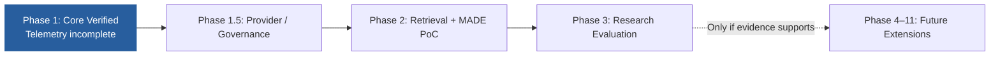

**水平研究軸**：Capability、Decision / Memory、Skill / Efficiency、Reliability Evolution，不綁定業務領域。CPU-first 小型 Decision Model 是 Phase 2/3 PoC 選項，**不依賴 Phase 7 的 Full Local LLM**。部署層可由 Single Process 演進為 Modular Monolith、Workers、多 Agent 與多租戶，但每一步都應以效益、安全／治理與實際資源需求決定，而非強制順序。

**資訊來源區分**：目前 dev 原始碼與實際測試提供「已完成／已驗證」事實；PROJECT_STATUS.md 提供最後一次已記錄的驗證進度；DEV_PLAN.md 定義近期待辦與階段退出條件；System Design 定義目標架構與研究契約。發現時序差異應標示，而不能以較新設計文稿推導 Runtime 完成。

---

# 70. 專案結構：Observed Source 與 Planned Logical Modules

### 70.1 2026-10-24 從 dev 確認的代表性檔案結構

```text
src/
├── main.py / config.py
├── agents/
│   ├── main_agent.py
│   └── evolution_agent.py
├── domain/
│   ├── capability.py / gap.py / approval.py / report.py
│   └── events.py / errors.py / research.py / telemetry.py
├── interfaces/
│   ├── llm.py / queue.py / sandbox.py
│   └── repository.py / telemetry_repository.py / notification.py
├── infrastructure/
│   ├── mock_llm.py / memory_queue.py / subprocess_sandbox.py
│   ├── sqlite_repository.py / sqlite_telemetry_repository.py
│   └── console_notification.py
├── services/
│   ├── capability_service.py / evolution_service.py / execution_service.py
│   ├── gap_detection_service.py / validation_service.py / testing_service.py
│   ├── approval_service.py / audit_service.py / policy_service.py
│   └── notification_service.py / report_store.py / research_metrics_service.py
└── api/routes/
    ├── tasks.py / capabilities.py / evolution.py
    └── approvals.py / audit.py / research.py

tests/
├── test_api.py / test_full_loop.py / test_concurrency.py
├── test_research_metrics.py / test_telemetry_repository.py
└── test_capability_*.py / support.py
```

本節列出的是**真正存在的路徑摘要**，不是整個檔案樹的逐檔清單；相關介面未必在現有 Runtime 使用，也不代表 Production Readiness。

### 70.2 建議邏輯模組邊界（Planned / Not Physical Directories）

```text
Task / Main Agent                         [existing core]
  ├─ DecisionModelInterface / Global / Local Decision    [planned]
  ├─ MemoryRouterInterface / Scoped Evidence Retrieval   [planned]
  ├─ Capability / Skill Execution                       [existing / extend]
  ├─ CodeBuilderRuntime + Secure Evolution Gate          [Phase 1.5 planned]
  ├─ TelemetryRepository / SQLite v1 Foundation         [implemented]
  │    ├─ Runtime Event Wiring / Aggregation             [Phase 1 incomplete]
  │    └─ DecisionExperience / Path Repository           [Phase 2 planned]
  └─ Policy / Audit / Approval Governance               [basic core; hardening planned]
```

後續可先在現有 `domain/`、`interfaces/`、`services/`、`infrastructure/` 中逐步加入新模組，再依規模分包；**不要求每個 Skill Package 獨立 DB、額外微服務或預先建立空的 `future/` 目錄**。遵守 Task/Trace/Decision Lineage、Capability Versioning、Memory Scope 和既有 Secure Evolution Gate。

---

# 71. 現階段的重要邊界／驗收證據

| Status | 對外可宣稱內容 | 尚不可宣稱 |
| --- | --- | --- |
| **Implemented & Historically Verified** | Mock Task→Gap→Generate→Test→Approval→Reuse；SQLite 核心儲存、Token/Cost 基礎 | 真實 LLM 自主泛化、Production-grade Governance |
| **Foundation Only** | Telemetry Domain、Repository、SQLite Schema v1 與 Contract Tests | Runtime 自動寫入全部 routing/exception/retry／完整 Summary API |
| **Phase 1 Outstanding** | Telemetry Runtime Wiring、Task/Trace Correlation、Failure Aggregation、Restart/Regression Tests | 未完成前不得標 Phase 1 Complete |
| **Phase 1.5 Planned** | Provider、Postgres、Docker、Code Builder、Main/Audit、Auth/Policy、Human Escalation | 任何元件已正式整合／通過真實安全驗證 |
| **Phase 2–3 Research** | MADE、Package Router、Validated Paths、Recovery、E1–E6 Baseline／Ablation | 尚無實測足以證實 Decision Stability 或降低 CPST |
| **Future / Opt-in** | Workers、Local Full LLM、Enterprise / Security、Sharing / Marketplace | 不是目前 MVP 的完成內容 |

**目前下一個真正工程里程碑**：按 DEV_PLAN.md 既定退出條件完成成功／失敗 routing trace、選擇證據、fallback / failure lineage、success denominator、Query / Summary、Token-Cost Correlation 與重啟讀回。Phase 1.5 的真實工具與安全硬化是其後工作；Phase 2/3 才做 Memory/Decision 效能實驗。

最新可查證的歷史測試紀錄是 **2026-10-18：35 passed, 1 warning**；本次僅檢查 Github dev 原始碼與文件，未重新執行測試或 benchmark。現有 Mock、SQLite、Subprocess 的成功測試**不證明**多 Tenant 隔離、自動修復、24/7 管理或可安全接入企業 production 系統。

`2.9–2.10、`8A、`53、`55.1 的治理限制維持：資料檢索、路徑選擇、執行授權與新 Artifact 啟用是不同決策；高信心與記憶命中不代表可跳過 Policy、Independent Validation 或必要的 Human Approval。

---

# 72. 商品化後的使用者控制

未來產品至少應讓使用者設定：

```text
Allow capability sharing?
[Yes / No]

Allow external capability discovery?
[Yes / No]

Allow capability recommendations?
[Yes / No]

Allow capability downloads?
[Manual / Organization Only / Trusted Sources]

Allow automatic updates?
[No / Notify Only / Trusted Capabilities]
```

預設使用最保守設定。

---

# 73. 最終能力流

CEAA 的完整能力流由 **Task Decision / Experience Reuse** 與 **Capability Gap / Governed Evolution** 共同組成，而不只有新能力生成。

### 73.1 通用任務與經驗閉環（Mermaid）

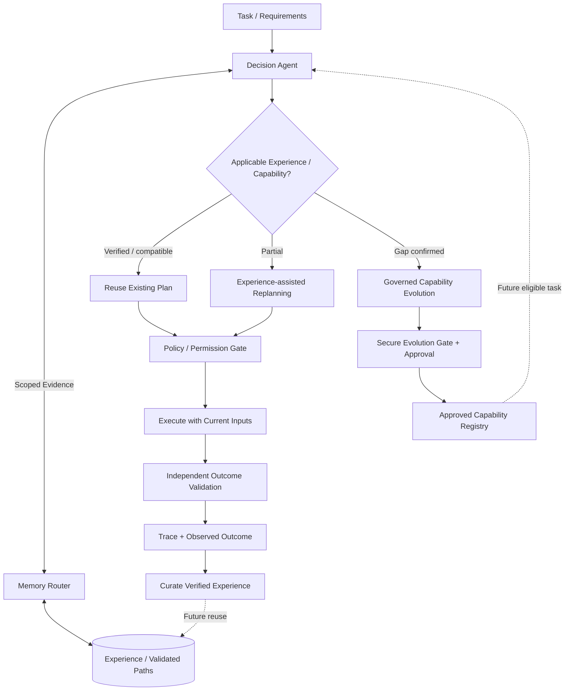

不適用的歷史路徑、低信心或 stale evidence 應回到受控推論／重新規劃；只有確認缺少足夠 Capability，才觸發 Gap / Evolution。上圖的 Gap / Evolution 是高階摘要；完整候選產生、雙重審查、沙箱測試及核准流程以 `8A 為準。

### 73.2 新能力建立與本地學習（保留）

```text
Task / Confirmed Gap
  ↓
Evolution Planner / Candidate Generation
  ↓
Independent Main / Audit Review + Validation / Testing
  ↓
Report + Policy + Human Approval（依既有治理規則）
  ↓
Approved Local Capability
  ↓
Future Reuse after Scope / Compatibility / Permission Check
```

### 73.3 可選分享（遠期、需 opt-in）

```text
Local Capability
 ↓
User Opt-In
 ↓
Sanitize
 ↓
Package
 ↓
Publish
```

### 73.4 可選取得（遠期、需本地驗證）

```text
Shared Registry
 ↓
User Opt-In
 ↓
Download
 ↓
Local Validation
 ↓
Local Testing
 ↓
Report
 ↓
Approval
 ↓
Local Agent
```

此處 **Memory / raw trace 不隨 Capability 分享自動輸出**；分享、取得及批准的權限規則仍依 `31–54。

---

# 74. 最終願景

Capability-Evolving Agent 不只是一個「能自己建立工具的 Agent」，也不只是把所有過往對話放進記憶庫的系統。

CEAA 的長期研究目標是：

> **建立一種能把真實執行經驗轉換成可信任、可檢索、可治理、可重用的能力與決策資產，並在任務需求改變時安全重新探索的通用 Agent 架構。**

### 互補的演化閉環

```text
Explore Unknown Task
       ↓
Plan / Execute / Observe / Validate
       ↓
Durable Execution Evidence
       ↓
├─ Capability Evolution → Build / Test / Govern / Activate
├─ Decision Evolution   → Retrieve / Rank / Select / Replan
├─ Efficiency Evolution → Optimize / Compress / Measure
└─ Reliability Evolution→ Diagnose / Recover / Verify
       ↓
Governed Reuse of Validated Knowledge and Capabilities
       ↓
New Tasks / New Evidence / Regression Checks
```

**MADE（Decision Agent × Memory Router）** 的角色是讓正確的歷史經驗在適當的任務與權限範圍內協助決策，而非取代人類治理或將 Agent 固定在過去的路線。已知且條件相容的問題可減少重複規劃；未知、低信心、風險較高或環境已改變的問題應安全重新推論／升級處理。

未來商品化時可再延伸 **Share → Discover → Transfer → Validate Locally → Adopt**，且始終維持使用者 opt-in、local validation、least privilege 與可撤銷治理。產品化可能帶來多 Agent／多租戶的能力網絡，但不屬於目前研究 MVP 已驗證的成效。

CEAA 的長期資產不只是一個 Capability Library，而是由 **Capability / Skill Registry、Validated Execution Paths、Decision Experience、Raw Execution Evidence 與 Governed Policies** 構成的版本化證據體系；底層 LLM、記憶後端和推論策略皆應保持可替換。

上述演化、節省成本、提高成功率與正確決策一致性均是 **待以基準實驗驗證的假說**，不因寫入設計文件就視為已證實。
