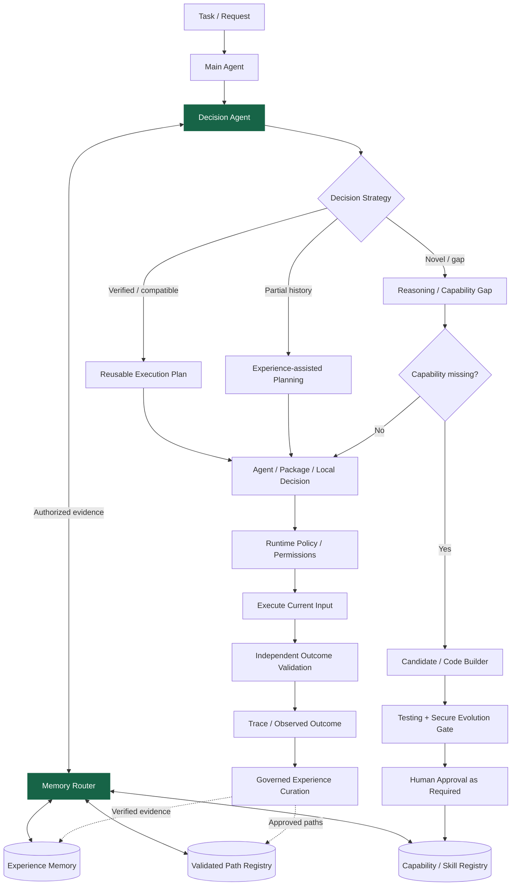

# Capability-Evolving Agent Architecture (CEAA)

**Language:** English | [繁體中文](README.zh-TW.md)


> [!WARNING]
> **Research prototype; not production-ready.** The currently implemented runtime uses a mock LLM, SQLite, a Python subprocess executor and console notifications. Real-provider support, hardened sandboxing, production authorization, independent Main/Audit secure review, Memory Router and Decision Agent runtime are **not yet integrated**. The current feature branch passed 59 tests on **2026-10-31**; this is controlled development evidence, not production assurance.

CEAA explores how agents can turn real execution history into **versioned, validated, reusable and governed capabilities and decisions**. Its core design is domain-neutral: specific workloads are experiments, not hardwired application architecture.

The current [System Design v1.9](Capability-Evolving%20Agent%20Architecture%20%E2%80%94%20System%20Design%20v1.9.md) describes two complementary research mechanisms:

1. **Capability Evolution:** discover a genuine capability gap, create and validate a candidate, secure the required approvals, activate an approved version, and reuse it.
2. **Experience-guided Decision Evolution:** use a **Decision Agent × Memory Router** to retrieve scoped historical evidence and choose among validated-plan reuse, experience-assisted planning, novel reasoning or capability evolution.

Skill Complexity Optimization, Reliability Evolution, hierarchical Package routing and long-term Cost Amortization extend these mechanisms. **None of their benefits are presumed proven.**

---

## Core North Star — Context-Aware Adaptive Decision Architecture (design goal, 2026-10-26)

**CEAA aims to provide a domain-neutral adaptive decision core, not one universal trading strategy or a domain-specific autonomous agent.** Given a task and changing environment, the future system should use currently available evidence to compare feasible actions (including defer, abstain and human escalation), assess applicability, uncertainty, risk, opportunity cost and resource limits, then choose a **context-relative best feasible action** under explicit policy and safety constraints. Subsequent outcomes should trigger independently validated learning or replanning when assumptions drift.

Capability Evolution and Experience-guided Decision Evolution are **mechanisms supporting this larger goal**, not a claim that any application will always receive the objectively optimal answer. A common decision/evidence/governance contract should be reusable across domains, while domain-specific Skills, data, tools, objectives and safety boundaries remain replaceable. Investment research, software development, enterprise operations and resource scheduling are candidate **evaluation contexts**, not baked-in assumptions.

**Status:** conceptual design only; the current Phase 1 runtime does not implement autonomous context-regime detection, adaptive strategy switching or cross-domain optimization. Phase 1 telemetry is the dependency; controlled Phase 2 PoCs and Phase 3 cross-domain/out-of-sample comparisons are proposed. See [System Design v1.9](Capability-Evolving%20Agent%20Architecture%20%E2%80%94%20System%20Design%20v1.9.md) and [DEV_PLAN.md](DEV_PLAN.md).

---

## Project Status

**Documentation aligned to v1.9 and the 2026-10-31 Phase 1 exit revision. Phase 1 exit criteria are verified on the current feature branch; integration into `dev` is still pending, and Phase 1.5 has not started.**

| Area | Verified status |
| --- | --- |
| Task → Capability Gap → Mock Generation → Validation / Testing → Approval → Active → Reuse | Core implemented; controlled tests recorded |
| FastAPI, SQLite capability/report/approval/audit, concurrency and restart persistence | Implemented; historical validation |
| Token / Cost Research foundation and research endpoints | Implemented; missing real provider usage remains unavailable |
| ExecutionTrace / RoutingDecision / Failure / Recovery domain, TelemetryRepository and SQLite schema v1 | **Foundation implemented**, contract tests recorded |
| Runtime telemetry, task/trace correlation, bounded retry/fallback evidence, missing-event detection, filtering and summary API | **Implemented and Phase 1 exit-verified on the current feature branch**; alternate targets are explicitly eligible, same-scope, idempotent, priority ordered and single-attempt |
| Real providers, Docker Sandbox, PostgreSQL adapter, CodeBuilderRuntime, independent Main/Audit Gate, auth/policy hardening | **Phase 1.5 planned; not implemented** |
| MemoryRouterInterface, DecisionModelInterface, Static Skill Packages, Validated Path Registry | **Phase 2 PoC planned; not implemented** |
| Reliable automated recovery, recursive multi-Agent organization, shared capability marketplace | Future / optional research |

**Current feature-branch full suite: 59 passed, 1 warning in 14.69s (2026-10-31)**. The warning is the existing Starlette/AnyIO `BlockingPortal` alias deprecation.

**Immediate next milestone:** integrate the verified feature branch, then begin the planned Phase 1.5 real-infrastructure and security hardening work. The Phase 1 exit suite now covers concurrent task/trace/event/cost correlation and restart-persistent missing-event detection. See [Execution Telemetry Database](docs/TELEMETRY_DATABASE.md).

**Actually implemented mock flow** (distinct from the full v1.9 design):

```text
Task → Search Active Capability
  ├─ Match → Execute Existing Capability
  └─ Miss → Capability Gap → Mock Generate → Validate / Test
          → Test Report → Pending Approval → Human Approval
          → Activate for Future Reuse
```

---

# 1. Research Motivation

CEAA examines whether Agent capabilities and **correct decision-making** can improve by reusing independently validated outcomes instead of repeatedly planning from scratch. Stronger foundation models, context windows and human-authored tools are useful, but they need not be the only source of improvement.

The research aims to test whether **Capability Accumulation**, **task-aware Memory Routing**, **Decision Stability**, **validated plan reuse**, **Skill Optimization** and **governed recovery** can improve end-to-end verified success and **Cost per Successful Task**. These are **hypotheses**, tested against frozen outcome oracles, equal resource/safety constraints, Exact/Near-Similar/Generalized workloads and suitable baselines — not marketing claims of measured superiority.

---

# 2. Core Concept

CEAA treats a **Capability** as a first-class executable, versioned, inspectable, testable, auditable and revocable asset. A Capability is not simply a prompt or memory snippet.

The architecture maintains distinct evidence layers:

- **Capability / Skill Registry:** what the system can execute, with interfaces, versions, eligibility and permission metadata.
- **Raw Operational History:** what was actually routed, executed, retried, rejected and observed, including failures.
- **Curated Decision Experience / Validated Execution Paths:** independently validated plan candidates with explicit provenance, versions, applicability, expiration and governance state.

**Memory Router supplies evidence; Decision Agent makes decisions; Policy Engine enforces permissions; validators determine outcomes.** Neither retrieving similar memory nor selecting a familiar plan is permission to execute a tool or activate a new artifact. Reuse means applying a **verified plan to current inputs**, not serving stale historical outputs.

> **Reason Once, Validate, Reuse When Applicable, Replan When Necessary.**

### Current evidence requirement

The repository now has automated Main Agent/runtime telemetry, bounded retry and governed alternate-target fallback evidence, provider-failure mapping, concurrent correlation and restart-persistent missing-event detection, with shared task/trace identity across token-cost metrics. These satisfy the defined Phase 1 evidence path on the current feature branch:

```text
Task / Trace → Routing Decision / Candidate Set / Selected Target
 → Execution Attempt → Success / Failure / Retry / Fallback
 → Independent Outcome / Cost → Durable Raw History
    ├─ Validated Episode → Curated Experience (future)
    └─ Population Analysis → Evolution Signals (future)
```

See [Telemetry Database](docs/TELEMETRY_DATABASE.md) and [Development Plan](DEV_PLAN.md).

---

# 3. High-Level Architecture

**Target v1.9 logical architecture — not the implemented Phase 1 runtime:**



The Global/Local Decision split is logical and future-facing. Memory Router is **not** an autonomous dispatcher or a bypass around scope controls. Reusing a previously approved compatible plan need not trigger an entire new-artifact review each time, but still requires current authorization and independent outcome validation. Newly generated or changed artifacts require the applicable Secure Evolution Gate and approval.

**Dependency boundary:** Agent → Service → Interface → Infrastructure Adapter. No core dependency on one LLM, vector index, data store or Builder provider.

---

# 4. Core Design Principles

## Capability First

Long-term assets include the **Capability/Skill Registry, verified Execution Paths, curated Decision Experience and raw outcome evidence** — not just the Capability Library or conversation history.

## Validation Before Activation

Generated capabilities must never become active immediately.

They must pass validation and testing first.

## Human-Governed Evolution

The Agent may autonomously generate and test capabilities, but new capabilities require administrator approval before first activation.

## Model Independent

The Agent architecture must not be tied to one model provider.

## Infrastructure Independent

Core logic should remain independent from PostgreSQL, Docker, Redis, NVIDIA NIM, OpenRouter, or any specific framework implementation.

## Implement Simple, Interface for Complex

Early implementations may be simple, but interfaces should support future scale.

## Everything Is Versioned

The design intends to version:

- Capability
- Capability schema
- test plan
- test report
- prompt
- model
- policy
- experiment
- artifact

## External Capabilities Are Untrusted by Default

Future imported capabilities must be locally validated before activation.

---

# 5. Capability Lifecycle

Planned lifecycle:

```text
Draft
 ↓
Candidate
 ↓
Validating
 ↓
Testing
 ↓
Tested
 ↓
Pending Approval
 ↓
Approved
 ↓
Active
 ↓
Deprecated
 ↓
Revoked
 ↓
Archived
```

If testing fails:

```text
Testing
 ↓
Failed
 ↓
Evolution Queue
```

If the administrator requests revision:

```text
Pending Approval
 ↓
Revision Requested
 ↓
Evolution Queue
```

---

# 6. Autonomous Testing and Test Reports

Testing is intentionally separated from capability generation.

The Evolution Agent is responsible for creating capabilities.

The Testing Agent is responsible for challenging them.

Planned test categories include:

- Functional Test
- Boundary Test
- Failure Test
- Regression Test
- Generalization Test
- Safety Test
- Performance Test

Each Capability version is intended to produce both:

```text
test_report.json
```

and:

```text
test_report.md
```

The report should eventually include:

- Capability ID and version
- test environment
- test cases
- pass rate
- failed cases
- regression result
- generalization score
- safety result
- performance metrics
- known limitations
- risk level
- recommended action

---

# 7. Human Approval and Notification

A capability that passes automated validation still does not automatically become active.

It enters:

```text
Pending Approval
```

The system then notifies an administrator.

The administrator may:

- Approve
- Reject
- Request Revision
- Approve With Restrictions

Notification and approval are deliberately separated:

```text
CapabilityReadyForReview
        ↓
Notification Service
        ↓
Administrator
        ↓
Approval Service
        ↓
Policy Engine
        ↓
Capability Registry
```

Future notification providers may include:

- Console
- Email
- Webhook
- Slack
- Microsoft Teams
- Mobile Push

---

# 8. Current Repository Structure

Representative paths observed on `dev` on 2026-10-24:

```text
src/
├── main.py / config.py
├── agents/main_agent.py / agents/evolution_agent.py
├── domain/
│   ├── capability.py / gap.py / approval.py / report.py
│   └── research.py / telemetry.py / events.py / errors.py
├── interfaces/
│   ├── llm.py / queue.py / sandbox.py / notification.py
│   └── repository.py / telemetry_repository.py
├── infrastructure/
│   ├── mock_llm.py / memory_queue.py / subprocess_sandbox.py
│   ├── sqlite_repository.py / sqlite_telemetry_repository.py
│   └── console_notification.py
├── services/
│   ├── capability_service.py / gap_detection_service.py
│   ├── evolution_service.py / execution_service.py
│   ├── testing_service.py / validation_service.py
│   ├── approval_service.py / audit_service.py / policy_service.py
│   └── notification_service.py / report_store.py / research_metrics_service.py
└── api/routes/
    ├── tasks.py / capabilities.py / evolution.py
    └── approvals.py / audit.py / research.py

tests/
├── test_api.py / test_full_loop.py / test_concurrency.py
├── test_research_metrics.py / test_telemetry_repository.py
└── test_capability_*.py / support.py
```

The planned Decision and Memory components are **logical interfaces, not currently existing directories or implemented services**. See System Design v1.9 §70.

---

# 9. Current Phase 1 Implementation

| Adapter boundary | Implemented adapter |
| --- | --- |
| LLM | `MockLLMProvider` — deterministic templates, no live reasoning provider |
| Capability persistence | SQLite |
| Execution evidence | SQLite `TelemetryRepository` **foundation only** |
| Queue | `InMemoryEvolutionQueue` — not a durable background worker |
| Sandbox | Python subprocess — **not secure container isolation** |
| Notifications | Console |
| API / orchestration | FastAPI / LangGraph |

Do not infer production authentication, multi-tenant data isolation, full Code Evolution Runtime or actual Memory-assisted Decision execution from this baseline.

---

# 10. Technology Stack

**Implemented dependencies:** Python, FastAPI, Pydantic, LangGraph, pytest, httpx and SQLite.

**Phase 1.5 candidates:** LiteLLM, NVIDIA NIM/OpenRouter or equivalent real LLM provider; PostgreSQL; Docker sandbox; replaceable CodeBuilderRuntime (Pi 1.x vs OpenCode under evaluation); auth, policy enforcement and independent Main/Audit reviews.

**Phase 2–3:** Embedding/pgvector or other retrieval backend, `MemoryRouterInterface`, `DecisionModelInterface`, static Package/Path Registry, optional Phoenix/DeepEval/MLflow. CPU-first lightweight decision inference may be evaluated here; a full local reasoning LLM is **not a prerequisite**.

**Future/optional:** Redis/RQ, gVisor/Firecracker/Kata, Streamlit/admin dashboard, Ollama/llama.cpp/vLLM. No vendor, local inference framework, or hardware architecture is a CEAA core hard dependency.

---

# 11. Phase 1 Runtime Validation

The current feature-branch integrated test result is **59 passed, 1 warning on 2026-10-31**. It includes telemetry/recovery contracts, provider-failure mapping, concurrent runtime/cost correlation, durable missing-event detection, bounded retry, governed alternate-target fallback and recovery-gate safety, restart persistence and query filters. Controlled concurrency and prior HTTP/Uvicorn evidence are documented in [PROJECT_STATUS.md](PROJECT_STATUS.md). These results do **not** establish a production-ready system, real token savings, or implemented MADE.

For a configured local environment:

```bash
pip install -r requirements.txt
pytest -q
uvicorn src.main:app --reload
```

With the server running, inspect the API at `http://localhost:8000/docs`.

Phase 1 is complete only when runtime success/failure/routing/retry/fallback telemetry is persisted and correlated with tasks and token/cost metrics, query/summary APIs and restart tests are verified against the [formal exit criteria](DEV_PLAN.md).

---

# 12. Roadmap — status-aware

| Phase | Objective | Status |
| --- | --- | --- |
| **1 — Core + Telemetry** | Mock capability lifecycle, token-cost foundation and durable execution/routing/failure history | **Complete on current feature branch**: all defined exit checks passed; integration into `dev` remains pending |
| **1.5 — Real Infrastructure + Governed Builder** | Real provider, PostgreSQL, Docker, CodeBuilderRuntime, independent Main/Audit, auth/policy and human oversight | **Planned / not implemented** |
| **2 — Retrieval + MADE PoC** | Scoped Capability/Memory Retrieval, decision routing, static Skill Packages, validated-path reuse, bounded recovery | **Planned / not implemented** |
| **3 — Evaluation** | E1 Capability/Cost, E2 Memory×Decision, E3 Skill Optimization, E4 Package Hierarchy, E5 Recovery, optional E6 HYSET tool-retrieval baseline | **Research design / not evaluated** |
| **4–7** | Background workers, stronger sandbox, dashboard and full local reasoning LLM | **Future / optional** |
| **8–9** | Domain-neutral enterprise and optional security research | **Future** |
| **10–11** | Opt-in capability sharing, shared registry and marketplace | **Future reserved** |

**Phase 1.5:** Pi 1.x and OpenCode are unselected Builder candidates. Future code-generated Skills/AgentArtifacts require independent reviewers, sandbox, security evidence, fail-closed governance and required approval; no mock-only test proves these are currently deployed.

**Phase 2:** Memory Router and Decision Agent are *general-purpose* coordination infrastructure, not an incident-management/ERP-specific solution. Memory ACL, plan applicability and runtime execution authorization are separate gates.

**Phase 3:** [v1.9 §56–60](Capability-Evolving%20Agent%20Architecture%20%E2%80%94%20System%20Design%20v1.9.md) standardizes independent success oracles, retrieval applicability, correct decision consistency vs wrong-but-stable behavior, false reuse, policy safety, latency and **Cost per Successful Task** (including retrieval, validation, retry and maintenance overhead). A higher hit rate or lower token count alone is not proof of improvement.

---
 
# 13. Future Reserved — Capability Sharing

Capability sharing is intentionally **not part of the current MVP**.

The architecture reserves space for future productization where users may choose whether to:

- share newly learned capabilities
- export capabilities
- import external capabilities
- discover community capabilities
- synchronize trusted capabilities

Potential future services:

```text
CapabilityImportService
CapabilityExportService
CapabilityPublishingService
CapabilityDiscoveryService
CapabilitySyncService
SharedCapabilityRegistry
```

Sharing must be opt-in.

Default principle:

```text
sharing_enabled = false
```

External capabilities must be considered untrusted until locally validated.

---

# 14. Future Capability Transfer Flow

Potential future publishing flow:

```text
Local Active Capability
       ↓
User Opt-In
       ↓
Privacy / Secret Scan
       ↓
Environment Neutralization
       ↓
Generalization Check
       ↓
Package
       ↓
Signature
       ↓
Shared Capability Registry
```

Potential acquisition flow:

```text
Shared Registry
      ↓
User Opt-In Download
      ↓
Signature Check
      ↓
Compatibility Check
      ↓
Local Sandbox Validation
      ↓
Testing Agent
      ↓
Local Test Report
      ↓
Administrator Approval
      ↓
Active Capability
```

A capability validated elsewhere is **not automatically trusted locally**.

---

# 15. Future Capability Marketplace

Long-term productization may include a Capability Marketplace supporting:

- private capabilities
- organization capabilities
- global capabilities
- verified publishers
- trust / reputation metadata
- version updates
- capability lineage
- forks
- revocation notices

Long-term concept:

```text
Agent A learns Capability X
        ↓
User chooses to share
        ↓
Shared Registry
        ↓
Agent B discovers X
        ↓
User chooses to acquire
        ↓
Local Validation
        ↓
Administrator Approval
        ↓
Agent B gains Capability X
```

This may enable:

> **Capability-level collective learning without exchanging model weights.**

---

# 16. Security and Governance Principles

Generated artifacts are untrusted until independently validated and governed. A **new or modified Skill/Workflow/Agent/Path version** must pass its Secure Evolution Gate, including independent Main/Audit reviews where applicable and required human authorization. **Reusing an already-approved, compatible plan** avoids unnecessary new-artifact review, but never bypasses current runtime permission checks, risk controls or outcome validation.

Memory Retrieval is scope-aware: tenant, branch, owner, resource classification, delegation and metadata/payload permissions are separate; denial or missing evidence cannot escalate an Agent's authority. Children may not exceed parental effective privileges. Raw execution traces, retrieved text, embeddings and generated rationale cannot become higher-priority instructions or silently accompany capability sharing.

**These are target design invariants.** Today's mock/subprocess code does not enforce all production-grade security requirements; real policy, sandbox and trusted reviewer enforcement are Phase 1.5+ work.

---

# 17. Documentation

| Document | Purpose |
| --- | --- |
| [System Design v1.9](Capability-Evolving%20Agent%20Architecture%20%E2%80%94%20System%20Design%20v1.9.md) | **Current architecture baseline** — MADE, governance, experimental metrics and phase boundaries |
| [DEV_PLAN.md](DEV_PLAN.md) | Implementation roadmap and official Phase 1/1.5 exit criteria |
| [PROJECT_STATUS.md](PROJECT_STATUS.md) | Actual recorded implementation status and tests |
| [DEVELOPMENT_LOG.md](DEVELOPMENT_LOG.md) | Historical engineering decisions and validation |
| [Telemetry Database](docs/TELEMETRY_DATABASE.md) | Implemented SQLite repository vs planned runtime integration |
| [Token/Cost Research](docs/TOKEN_COST_RESEARCH.md) | Measurement contract and caveats |
| [Multi-Agent Organization Design](docs/MULTI_AGENT_ORGANIZATION_DESIGN.md) | Future permission monotonicity and branch governance |
| [Future Platform Vision](docs/AGENT_PLATFORM_FUTURE_VISION.md) | Long-term conditional productization |
| System Design v1.8 / v1.7 | Historical snapshots, **not** the current design baseline |

Source of truth: `dev` source and tests for implementation; PROJECT_STATUS for recorded evidence; DEV_PLAN for near-term work; v1.9 for proposed architecture. A diagram or design version is not proof of runtime support.

---

# 18. Development Philosophy

> **Implement simple, interface for complex — preserve evidence and governance.**

Build a verified local core, finish durable telemetry and real-security infrastructure, then evaluate general-purpose Memory-assisted Decision and path reuse. Add hierarchy, persistent services and new autonomy only when independent experiments demonstrate value.

```text
Verified Core → Runtime Telemetry → Real Provider / Secure Evolution
 → Capability + Memory / Decision PoC → Independent Evaluation
 → Evidence-justified Scale / Optional Productization
```

The result may show a mechanism is useful only for certain task types or not worth its overhead; such findings are valid research outcomes.

---

# 19. Long-Term Vision

CEAA aims to create a governed, domain-neutral Agent architecture in which **capability evolution, decision evolution, efficiency optimization and reliability evolution** are driven by verifiable operational experience.

```text
Task → Decision / Authorized Retrieval / Exploration
 → Policy-constrained Execution → Independent Validation
 → Raw Experience → Governed Curation
    ├─ Capability: Build / Test / Approve / Activate
    ├─ Decision: Route / Reuse / Replan
    ├─ Efficiency: Optimize / Compress / Evaluate
    └─ Reliability: Diagnose / Recover / Verify
 → Versioned Evidence and Approved Assets for Future Tasks
```

The long-term assets include a **Capability/Skill Registry, Decision Experience, Validated Execution Paths, Raw Traces and Governance Policies**, not just a collection of tools or old conversations. Future optional sharing requires user opt-in and local validation, and never implicitly exports private memory.

## Current Immediate Priority

**Complete Phase 1 Execution Experience & Evolution Telemetry runtime writing, correlation, aggregation and restart tests before Phase 1.5 integration.** See [DEV_PLAN.md](DEV_PLAN.md).

---

## License and Use

This repository is publicly visible primarily for **portfolio review, research discussion, technical evaluation, and educational inspection**.

The project is **source-available, not open source**. You may view, study, and run the code locally for personal, educational, research, or evaluation purposes. Commercial production use, redistribution, sublicensing, hosted-service use, or use as the basis of a competing commercial product requires separate written permission.

See [LICENSE](LICENSE) for the complete terms.

Third-party libraries, models, APIs, datasets, and other dependencies remain subject to their own licenses and terms.

