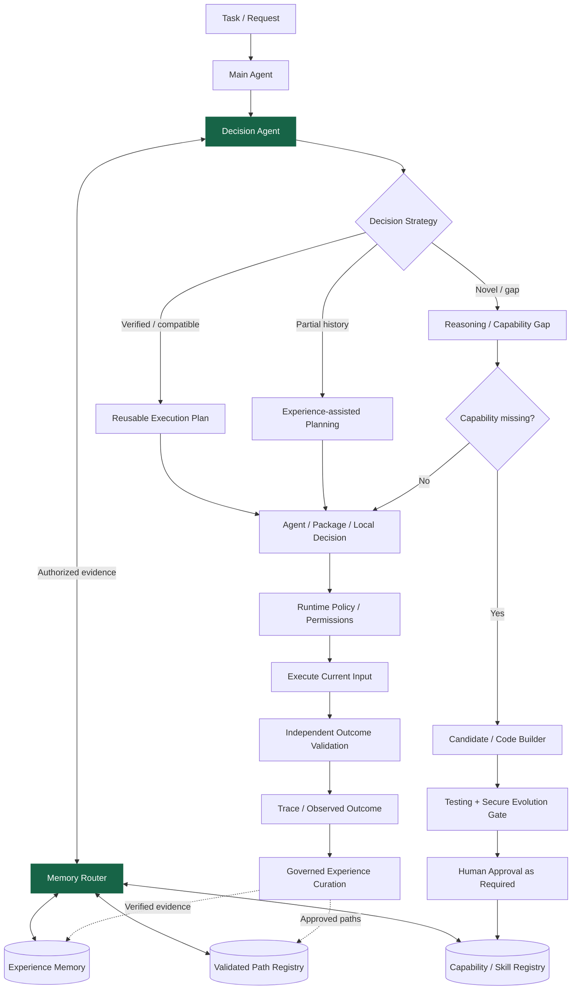

# Capability-Evolving Agent Architecture（CEAA）

**語言：** [English](README.md) | 繁體中文


> [!WARNING]
> **研究原型，尚非可部署於生產環境的系統。** 現有 Runtime 使用 Mock LLM、SQLite、Python subprocess 與 Console Notification。真實 LLM Provider、正式安全隔離、完整認證授權、獨立 Main/Audit Secure Evolution Gate、Memory Router 與 Decision Agent Runtime **尚未整合**。目前 feature 分支於 **2026-10-31** 通過 59 項測試；這是受控開發證據，不是 production assurance。

CEAA 研究如何將 Agent 的實際執行經驗轉換成**經驗證、可重用、可版本管理、可治理的能力與決策資產**，在維持安全與結果驗證的前提下減少不必要的重複推論。架構保持**領域中立**，特定應用只作為實驗工作負載，不成為核心設計依賴。

目前的 [System Design v1.9](Capability-Evolving%20Agent%20Architecture%20%E2%80%94%20System%20Design%20v1.9.md) 已定義兩條互補的研究路線：

1. **Capability Evolution（能力演化）**：確認能力缺口、產生並測試候選、完成治理與必要核准、啟用版本化能力，再供未來任務重用。
2. **Experience-guided Decision Evolution（經驗輔助決策演化）**：以 **Decision Agent × Memory Router** 檢索權限範圍內、有來源證據的歷史經驗，在成熟計畫重用、經驗輔助規劃與全新推論／能力演化之間選擇。

Skill Complexity Optimization、Reliability Evolution、階層式 Package 與長期推論成本攤提都是**待實驗驗證**的延伸方向，不能當作已經證明的性能結果。

---

## 核心願景：跨場景的環境感知與自適應決策（2026-10-26 設計目標）

**CEAA 的核心不是替單一領域建立固定策略，而是建立可跨場景重用的自適應決策架構。** 系統應依任務目標、當下環境與可取得的證據，比較可執行的行動方案（包括暫緩、不執行與人工介入），衡量適用性、不確定性、風險、機會成本、資源與權限限制，在此脈絡下尋找**相對最佳的可行決策**。環境或關鍵假設改變時，再以結果驗證及決策歷史觸發重新評估，而非持續套用過往有效的規則。

Capability Evolution 與 Experience-guided Decision Evolution 是支撐這個共同目標的**核心機制**，不是保證任何場景都能得到客觀最優解。共同的決策／證據／治理契約應保持領域中立；投資、軟體開發、企業營運、情報分析及資源調度等場景，透過可替換的資料、Skill Package、工具與安全限制接入，並作為未來**跨領域驗證場景**。

**狀態：設計原則，尚未實作。** Phase 1 的 Runtime 尚不具備自主 Regime Detection、動態策略切換或跨場景最佳化；先完成既有 Telemetry 證據基礎，Phase 2 規劃受控 PoC，Phase 3 透過多場景、樣本外與環境變化測試驗證。詳見 [System Design v1.9](Capability-Evolving%20Agent%20Architecture%20%E2%80%94%20System%20Design%20v1.9.md) 與 [DEV_PLAN.md](DEV_PLAN.md)。

---

## 開發方向已收斂（Direction Baseline，2026-10-26）

專案固定三項上位原則：**跨場景通用決策核心、依當下脈絡及風險選擇相對最佳可行行動、以可驗證經驗持續調整**。因此不以單一金融或企業應用取代核心研究，也不把特定模型、交易策略或工具視為長期硬依賴。

**近期工程順序維持不變**：先完成 Phase 1 Execution Telemetry → 再進入 Phase 1.5 真實運行與安全治理 → Phase 2 最小自適應決策 PoC → Phase 3 跨場景與環境變化對照實驗。未來想法先進 Backlog，不任意擴張 Phase 1；細節與變更規則以 [DEV_PLAN.md](DEV_PLAN.md) 的 Direction Baseline 為準。

這是**開發方向基準**，不是聲稱自適應決策已經實作，亦不代表技術或研究假說從此不能修改。

---

## 專案狀態

**文件已對齊 v1.9 與 2026-10-31 Phase 1 退出修訂。目前 feature 分支已通過 Phase 1 退出條件；尚待整合至 `dev`，Phase 1.5 尚未開始。**

| 功能 | 目前狀態 |
| --- | --- |
| Task → Capability Gap → Mock Generation → Validation / Testing → Approval → Active → Reuse | 核心已實作，有受控測試紀錄 |
| FastAPI、SQLite Capability/Report/Approval/Audit、併發及重啟持久化 | 已實作，已有歷史驗證 |
| Token / Cost Research Foundation 與研究 API | 已實作；缺少的真實 Provider Usage 維持 unavailable |
| ExecutionTrace / RoutingDecision / Failure / Recovery Domain、TelemetryRepository、SQLite Schema v1 | **資料層基礎已建立**，Repository 測試已記錄 |
| Runtime 自動寫入、Task/Trace 關聯、bounded retry/fallback 證據、missing-event detection、查詢與 Summary API | **目前 feature 分支已實作並完成 Phase 1 退出驗證**；替代目標須明確標記、同 scope、冪等、依優先序且每個 target 僅嘗試一次 |
| Real LLM、Docker Sandbox、PostgreSQL Adapter、CodeBuilderRuntime、獨立 Main/Audit Gate、完整 Auth/Policy | **Phase 1.5 規劃中，未實作** |
| MemoryRouterInterface、DecisionModelInterface、Static Skill Packages、Validated Path Registry | **Phase 2 PoC 規劃中，未實作** |
| 完整自動修復、遞迴多 Agent 組織、Capability Sharing / Marketplace | 遠期研究／可選商品化 |

**目前 feature 分支完整整合測試：2026-10-31，59 passed、1 warning（14.69s）。** 警告為既有 Starlette／AnyIO `BlockingPortal` alias 棄用。

**下一個真正的工程里程碑**是整合已驗證的 feature 分支，之後進入 Phase 1.5 的真實基礎設施與安全強化。Phase 1 退出套件已涵蓋並行 task/trace/event/cost 關聯，以及重啟後仍可辨識的 missing-event detection。詳見 [Telemetry Database](docs/TELEMETRY_DATABASE.md)。

**現有已實作的 Mock 核心流程**（與 v1.9 完整目標架構不同）：

```text
Task → Search Active Capability
  ├─ Match → Execute Existing Capability
  └─ Miss → Capability Gap → Mock Generate → Validate / Test
          → Test Report → Pending Approval → Human Approval
          → Activate for Future Reuse
```

---

# 1. 研究動機

CEAA 的研究問題是：Agent 能否透過**累積經驗證的能力與正確決策經驗**改善長期任務表現，而不是每次都從零重新規劃？更強的基礎模型、上下文與人工加入工具仍有其價值，但不一定是唯一的能力成長方式。

具體研究假設包含 **Capability Accumulation、Task-aware Memory Routing、Decision Stability、Validated Path Reuse、Skill Optimization 與 Governed Recovery** 是否能提高經獨立驗證的任務成功率，並降低 **Cost per Successful Task**。實驗須控制模型／工具／權限／成本，使用 Exact、Near-Similar、Generalized 任務、獨立 Outcome Oracle 與合適 Baseline；**不能預先宣稱效果已經證實**。

---

# 2. 核心概念

CEAA 將 **Capability** 視為一等系統資產：可執行、可檢查、可測試、可版本管理、可稽核、可撤銷、可重用，而不只是 Prompt 或 Memory。

系統邏輯上分離三類證據：

- **Capability / Skill Registry**：系統目前有哪些能力，包括介面、版本、適用限制與權限。
- **Raw Operational History**：實際如何路由、呼叫、執行、重試、失敗或回退，及最終觀測結果。
- **Curated Decision Experience / Validated Execution Paths**：經獨立驗證、可追溯來源且有明確相容／失效條件的可重用計畫。

**Memory Router 負責提供證據；Decision Agent 負責選擇策略；Policy Engine 負責授權；獨立 Validator 負責判定結果。** 找到相似歷史記憶，不代表取得工具執行權限，也不代表可以直接啟用新的 Artifact。重用的是**已驗證的執行計畫**，不是舊答案、祕密或過時狀態。

> **Reason Once, Validate, Reuse When Applicable, Replan When Necessary.**

### 現階段的經驗資料基礎

目前 Main Agent／Runtime 已自動寫入 Telemetry、保存 bounded retry、受治理 alternate-target fallback、provider failure、並行關聯及 missing-event 證據，並以同一 Task/Trace identity 串接 Token/Cost metrics。目前 feature 分支已滿足既定 Phase 1 evidence path：

```text
Task / Trace → Routing Decision / Candidate Set / Selected Target
 → Execution Attempt → Success / Failure / Retry / Fallback
 → Independent Outcome / Cost → Durable Raw History
    ├─ Validated Episode → Curated Experience（未來）
    └─ Population Analysis → Evolution Signals（未來）
```

詳見 [Telemetry Database](docs/TELEMETRY_DATABASE.md) 與 [DEV_PLAN.md](DEV_PLAN.md)。

---

# 3. 高階系統架構

**以下 Mermaid 為 v1.9 的通用目標架構，不代表現有 Phase 1 Runtime 已實作所有元件。**



Global／Local Decision 是後續架構中不同層級的決策責任；Memory Router **不是**獨立的任務分派 Agent，也不能繞過 Scope、Policy 或 Independent Validation。既有已核准且相容的執行計畫不必每次都重新跑新 Artifact 審查，但仍要當次授權與結果驗證；新建或更改 Artifact 必須進入對應的 Secure Evolution Gate。

**依賴原則**：Agent → Service → Interface → Infrastructure Adapter，不綁定特定 LLM、向量資料庫或 Builder。

---

# 4. 核心設計原則

## Capability First

長期累積的資產包括 **Capability/Skill Registry、Validated Execution Paths、Curated Decision Experience 與 Raw Outcome Evidence**，而不只是 Capability Library 或對話紀錄。

## Validation Before Activation

新產生的 Capability 不得立即啟用。

必須先通過驗證與測試。

## Human-Governed Evolution

Agent 可以自主建立與測試 Capability，但新能力第一次正式啟用前仍需要管理員核准。

## Model Independent

Agent 架構不得綁定單一模型供應商。

## Infrastructure Independent

核心邏輯應與 PostgreSQL、Docker、Redis、NVIDIA NIM、OpenRouter 或任何特定 framework implementation 解耦。

## Implement Simple, Interface for Complex

早期 implementation 可以簡單，但 interface 必須保留未來擴充能力。

## Everything Is Versioned

規劃版本化的物件包括：

- Capability
- Capability schema
- test plan
- test report
- prompt
- model
- policy
- experiment
- artifact

## External Capabilities Are Untrusted by Default

未來匯入的外部 Capability，在本地驗證完成之前一律視為不受信任。

---

# 5. Capability Lifecycle

規劃生命週期：

```text
Draft
 ↓
Candidate
 ↓
Validating
 ↓
Testing
 ↓
Tested
 ↓
Pending Approval
 ↓
Approved
 ↓
Active
 ↓
Deprecated
 ↓
Revoked
 ↓
Archived
```

如果測試失敗：

```text
Testing
 ↓
Failed
 ↓
Evolution Queue
```

如果管理員要求修改：

```text
Pending Approval
 ↓
Revision Requested
 ↓
Evolution Queue
```

---

# 6. 自主測試與 Test Report

Testing 與 Capability Generation 刻意分離。

Evolution Agent 負責建立 Capability。

Testing Agent 負責挑戰 Capability，嘗試找出它可能失敗的地方。

規劃中的測試類型包括：

- Functional Test
- Boundary Test
- Failure Test
- Regression Test
- Generalization Test
- Safety Test
- Performance Test

每一個 Capability version 預期產生：

```text
test_report.json
```

以及：

```text
test_report.md
```

Test Report 未來應包含：

- Capability ID 與版本
- 測試環境
- Test Cases
- Pass Rate
- Failed Cases
- Regression Result
- Generalization Score
- Safety Result
- Performance Metrics
- Known Limitations
- Risk Level
- Recommended Action

---

# 7. Human Approval 與 Notification

即使 Capability 通過自動驗證，也不會自動進入 Active。

它會先進入：

```text
Pending Approval
```

接著系統通知管理員。

管理員可以：

- Approve
- Reject
- Request Revision
- Approve With Restrictions

Notification 與 Approval 被刻意分離：

```text
CapabilityReadyForReview
        ↓
Notification Service
        ↓
Administrator
        ↓
Approval Service
        ↓
Policy Engine
        ↓
Capability Registry
```

未來 Notification Provider 可包括：

- Console
- Email
- Webhook
- Slack
- Microsoft Teams
- Mobile Push

---

# 8. 目前 Repository 結構

2026-10-24 從 `dev` 核對的代表性路徑：

```text
src/
├── main.py / config.py
├── agents/main_agent.py / agents/evolution_agent.py
├── domain/
│   ├── capability.py / gap.py / approval.py / report.py
│   └── research.py / telemetry.py / events.py / errors.py
├── interfaces/
│   ├── llm.py / queue.py / sandbox.py / notification.py
│   └── repository.py / telemetry_repository.py
├── infrastructure/
│   ├── mock_llm.py / memory_queue.py / subprocess_sandbox.py
│   ├── sqlite_repository.py / sqlite_telemetry_repository.py
│   └── console_notification.py
├── services/
│   ├── capability_service.py / gap_detection_service.py
│   ├── evolution_service.py / execution_service.py
│   ├── testing_service.py / validation_service.py
│   ├── approval_service.py / audit_service.py / policy_service.py
│   └── notification_service.py / report_store.py / research_metrics_service.py
└── api/routes/
    ├── tasks.py / capabilities.py / evolution.py
    └── approvals.py / audit.py / research.py

tests/
├── test_api.py / test_full_loop.py / test_concurrency.py
├── test_research_metrics.py / test_telemetry_repository.py
└── test_capability_*.py / support.py
```

規劃中的 Decision / Memory 元件目前是**邏輯介面設計，不是已存在的程式目錄或服務**；參考 System Design v1.9 §70。

---

# 9. 目前 Phase 1 Implementation

| 職責 | 現有 Adapter |
| --- | --- |
| LLM | `MockLLMProvider`（固定模板，不是真實推論 Provider） |
| Capability Persistence | SQLite |
| Execution Evidence | SQLite `TelemetryRepository`、Runtime Writing、bounded retry、受治理 alternate-target fallback、並行關聯、missing-event detection、Recovery contracts 與 Summary/Filter API 已建立並完成 Phase 1 退出驗證 |
| Queue | `InMemoryEvolutionQueue`（非持久化背景 Worker） |
| Sandbox | Python subprocess（**不等於正式安全隔離**） |
| Notification | Console |
| API / Orchestration | FastAPI / LangGraph |

目前能驗證受控的核准與能力重用流程，但不能宣稱具備 Production Auth、Multi-tenant Isolation、完整 CodeBuilderRuntime 或 MADE 的執行能力。

---

# 10. 目前技術棧

**已整合程式依賴：** Python、FastAPI、Pydantic、LangGraph、pytest、httpx、SQLite。

**Phase 1.5 候選：** LiteLLM、NVIDIA NIM／OpenRouter 等真實 Provider、PostgreSQL、Docker Sandbox；Pi 1.x 與 OpenCode 為尚未選定的 Builder Runtime 候選；Auth/Policy 與獨立 Main/Audit Reviews。

**Phase 2–3：** Embedding／pgvector 等可替換檢索後端、`MemoryRouterInterface`、`DecisionModelInterface`、Static Packages / Path Registry，以及可選 Phoenix／DeepEval／MLflow。CPU-first 的小型 Decision Model 可以在 Phase 2/3 研究，不需要等待完整 Local Reasoning LLM。

**更遠期可選：** Redis/RQ、gVisor／Firecracker／Kata、Streamlit／Admin UI、Ollama／llama.cpp／vLLM。技術與硬體是否適用仍須以受控實測決定；目前 Mock Baseline 沒有證明真實推論成本節省。

---

# 11. Phase 1 Runtime Validation

目前 feature 分支完整整合測試為 **2026-10-31：59 passed、1 warning**，已包含 Telemetry／Recovery contracts、provider failure mapping、並行 Runtime／cost correlation、持久 missing-event detection、bounded retry、受治理 alternate-target fallback／recovery-gate safety、restart persistence 與 query filters。受控併發及既有 HTTP/Uvicorn 證據詳見 [PROJECT_STATUS.md](PROJECT_STATUS.md)。這些結果仍不代表 Production 安全驗證、真實 Token 節省或 MADE 已實作。

本機已安裝相依套件時可執行：

```bash
pip install -r requirements.txt
pytest -q
uvicorn src.main:app --reload
```

伺服器啟動後可至 `http://localhost:8000/docs` 查看 API。

只有當成功／失敗／路由／重試／回退的 Runtime Telemetry、Task/Trace Correlation、Summary API 與 Restart Tests 都符合 [正式 Phase 1 退出條件](DEV_PLAN.md) 時，才能標記 Phase 1 Complete。

---

# 12. Roadmap — 依實作狀態區分

| 階段 | 核心目標 | 狀態 |
| --- | --- | --- |
| **Phase 1 — Core + Telemetry** | Mock Capability Lifecycle、Token/Cost 基礎與完整執行／路由／失敗資料 | **目前 feature 分支已完成**：所有既定退出檢查通過；尚待整合至 `dev` |
| **Phase 1.5 — Real Infrastructure + Governed Builder** | 真實 Provider、PostgreSQL、Docker、CodeBuilderRuntime、Main/Audit、Auth/Policy 與 Human Governance | **規劃中，未實作** |
| **Phase 2 — Retrieval + MADE PoC** | Capability/Memory Retrieval、Decision Routing、Static Skill Packages、Validated Path 與有限 Recovery | **規劃中，未實作** |
| **Phase 3 — Evaluation** | E1 Capability/Cost、E2 Memory×Decision、E3 Skill Optimization、E4 Package Hierarchy、E5 Recovery、可選 E6 HYSET | **研究設計完成，尚未實驗驗證** |
| **Phase 4–7** | Background Workers、強化隔離、Dashboard、完整本地 Reasoning LLM | **遠期／可選** |
| **Phase 8–9** | 領域中立企業驗證與可選資安研究 | **遠期** |
| **Phase 10–11** | Opt-in Capability Sharing、Shared Registry、Marketplace | **遠期預留** |

**Phase 1.5：** Pi 1.x 與 OpenCode 是待比較的 Builder 候選，不是已部署元件。未來 Builder 產生的新 Skill／AgentArtifact 需有獨立 Main/Audit 審查、沙箱、安全證據、Fail Closed 與必要人工核准。

**Phase 2：** Memory Router 與 Decision Agent 是可被不同任務共用的**通用決策基礎設施**，不應綁定系統錯誤、ERP 或其他特定領域；記憶讀取授權、路徑適用性與工具執行授權是不同檢查。

**Phase 3：** [v1.9 §56–60](Capability-Evolving%20Agent%20Architecture%20%E2%80%94%20System%20Design%20v1.9.md) 統一定義 Verified Task Success、Retrieval Applicability、Correct Decision Consistency（區別穩定但錯誤）、False Reuse、Policy Safety、Latency 與 **Cost per Successful Task**，納入檢索、驗證、重試和維護成本。單純提高命中率或降低 Token 不代表架構較好。

---

# 13. Future Reserved — Capability Sharing

Capability Sharing **刻意不納入目前 MVP**。

架構先預留未來商品化後，讓使用者可以自行選擇是否：

- 分享新學到的 Capability
- Export Capability
- Import 外部 Capability
- Discover Community Capability
- 同步 Trusted Capability

未來可能的 service：

```text
CapabilityImportService
CapabilityExportService
CapabilityPublishingService
CapabilityDiscoveryService
CapabilitySyncService
SharedCapabilityRegistry
```

分享必須採 opt-in。

預設原則：

```text
sharing_enabled = false
```

所有外部 Capability 在本地驗證前都必須視為不受信任。

---

# 14. 未來 Capability Transfer Flow

可能的 Publish 流程：

```text
Local Active Capability
       ↓
User Opt-In
       ↓
Privacy / Secret Scan
       ↓
Environment Neutralization
       ↓
Generalization Check
       ↓
Package
       ↓
Signature
       ↓
Shared Capability Registry
```

可能的取得流程：

```text
Shared Registry
      ↓
User Opt-In Download
      ↓
Signature Check
      ↓
Compatibility Check
      ↓
Local Sandbox Validation
      ↓
Testing Agent
      ↓
Local Test Report
      ↓
Administrator Approval
      ↓
Active Capability
```

即使 Capability 已在其他環境通過驗證，也**不代表在本地可以直接信任**。

---

# 15. 未來 Capability Marketplace

長期商品化可能包含 Capability Marketplace，支援：

- private capabilities
- organization capabilities
- global capabilities
- verified publishers
- trust / reputation metadata
- version updates
- capability lineage
- forks
- revocation notices

長期概念：

```text
Agent A learns Capability X
        ↓
User chooses to share
        ↓
Shared Registry
        ↓
Agent B discovers X
        ↓
User chooses to acquire
        ↓
Local Validation
        ↓
Administrator Approval
        ↓
Agent B gains Capability X
```

這可能形成：

> **不交換模型權重的 Capability-level collective learning。**

---

# 16. Security 與 Governance 原則

新產生的 Artifact 必須先經獨立驗證與治理；**新建或修改 Skill／Workflow／Agent／Path 版本**需走對應的 Secure Evolution Gate，包括適用的 Main/Audit 審查及人類授權。**既有、已核准且相容的計畫重用**不必每次再做完整新能力生成審查，但不能跳過當次 Policy、風險限制與結果驗證。

Memory Retrieval 須依可信身份、Tenant、Branch、Resource、資料分類與授權範圍過濾。父子 Agent 權限不可往下擴張；高相似度或高信心無法蓋過 DENY。Raw Trace、Embedding、Decision Rationale 與私有記憶不會自動隨 Capability 分享。

**這些是目標治理不變量**，不代表現在的 Mock／Subprocess Runtime 已具備完整 Production 安全能力；真正的授權、隔離與獨立審查要在 Phase 1.5 之後逐步實作。

---

# 17. 文件管理

| 文件 | 用途 |
| --- | --- |
| [System Design v1.9](Capability-Evolving%20Agent%20Architecture%20%E2%80%94%20System%20Design%20v1.9.md) | **目前正式架構基準**：MADE、治理、研究指標、開發階段 |
| [DEV_PLAN.md](DEV_PLAN.md) | 近期開發計畫與 Phase 1/1.5 退出條件 |
| [PROJECT_STATUS.md](PROJECT_STATUS.md) | 實際已記錄的實作狀態、測試與待辦 |
| [DEVELOPMENT_LOG.md](DEVELOPMENT_LOG.md) | 開發歷程與驗證紀錄 |
| [Telemetry Database](docs/TELEMETRY_DATABASE.md) | 已建立的 SQLite 資料層及未來 Runtime 整合 |
| [Token/Cost Research](docs/TOKEN_COST_RESEARCH.md) | 量測契約與限制 |
| [Multi-Agent Organization Design](docs/MULTI_AGENT_ORGANIZATION_DESIGN.md) | 未來階層權限、Branch Governance |
| [Future Platform Vision](docs/AGENT_PLATFORM_FUTURE_VISION.md) | 研究驗證後才考慮的商品化願景 |
| System Design v1.8 / v1.7 | 歷史設計快照，**不是最新架構基準** |

真實功能應以 `dev` 原始碼與測試為準；PROJECT_STATUS 提供最後已記錄的實作證據，DEV_PLAN 提供階段退出條件，v1.9 定義**目標設計**。不能因文件畫出新架構就視為已實作。

---

# 18. Development Philosophy

> **Implement simple, interface for complex — 同時保留證據與治理。**

先建立可驗證的本地核心、完成 Durable Telemetry，再導入 Real Provider / Secure Evolution；之後才驗證通用 Memory-assisted Decision 與執行路徑重用。只有在實驗證明有價值時才增加 Agent 層級、常駐服務與組織複雜度。

```text
Verified Core → Runtime Telemetry → Real Provider / Secure Evolution
 → Capability + Memory / Decision PoC → Independent Evaluation
 → Evidence-justified Scale / Optional Productization
```

研究允許發現某種記憶路由或階層策略不划算，負面結果仍是有效研究證據。

---

# 19. 長期願景

CEAA 希望成為**通用、可治理、能依經驗持續改進的 Agent 架構**。Capability Evolution、Decision Evolution、Performance / Efficiency Optimization 及 Reliability Evolution 都以可驗證的真實執行證據為基礎。

```text
Task → Decision / Authorized Retrieval / Exploration
 → Policy-constrained Execution → Independent Validation
 → Raw Experience → Governed Curation
    ├─ Capability：Build / Test / Approve / Activate
    ├─ Decision：Route / Reuse / Replan
    ├─ Efficiency：Optimize / Compress / Evaluate
    └─ Reliability：Diagnose / Recover / Verify
 → Versioned Evidence and Approved Assets for Future Tasks
```

長期資產不只是 Capability Library，還包括 **Capability/Skill Registry、Decision Experience、Validated Execution Paths、Raw Traces、Governance Policies**。未來 Capability Sharing 需要使用者明確 opt-in 與本地驗證，不會隱含輸出私有記憶。

## 目前立即優先事項

**先完成 Phase 1 的 Execution Experience & Evolution Telemetry Runtime Wiring、資料關聯、Aggregation 與重啟測試，再開始 Phase 1.5 的真實 Provider、Sandbox 與 Builder 整合。** 詳見 [DEV_PLAN.md](DEV_PLAN.md)。

---

## 使用授權

本 Repository 公開的主要目的為 **求職作品集展示、研究交流、技術評估與教育性檢視**。

本專案採 **Source-Available（原始碼可見）** 授權，**不是一般意義上的 Open Source License**。你可以閱讀、研究，並在個人、教育、研究或評估用途下於本機執行程式；若要用於商業正式環境、重新散布、再授權、提供 Hosted Service，或作為競爭性商業產品的基礎，需另行取得著作權人書面授權。

完整條款請見 [LICENSE](LICENSE)。

第三方函式庫、模型、API、資料集與其他依賴項目，仍分別受其原有授權與使用條款約束。

